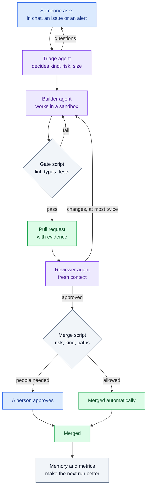

# The Software Factory Manifesto

> **In short:** AI agents can turn requests into merged code on their own. They do it safely only
> when the environment makes bad changes hard and proof mandatory. Build that environment first,
> then hand over the work.

📖 **Read it as a website:** https://icelink-ai.github.io/software-factory-manifesto/

## What is a software factory?

A software factory is a system where AI agents do the routine work of shipping code. Someone asks
for a change in chat. An agent builds it in an isolated machine, proves it works, and a policy
decides whether it can merge. People decide what to build and accept the risk.

This manifesto collects what works. It draws on ten talks by teams that run factories, and on the
factory we run ourselves. Every practice is written so a person can understand it and an AI agent
can follow it.

## Start here

| If you want to… | Read |
|---|---|
| See how it works, start to finish | [The journey of a request](docs/00-journey/README.md): one bug report, nine stages |
| Build your own factory | [Start your factory](docs/09-adoption/build-order.md): five phases with exit criteria |
| Check a rule | [All rules](RULES.md): every rule by id |
| Point an AI agent at this | [AGENTS.md](AGENTS.md) and [llms.txt](llms.txt) |

## The nine ideas

1. **Decide before you build.** A read-only agent works out what each request is, how risky it is,
   and what "done" means. → [Work intake](docs/01-work-intake/README.md)
2. **Let code move the work.** Scripts and a state machine decide what happens next. Models only
   make judgment calls inside a stage. → [Deterministic spine](docs/02-deterministic-spine/README.md)
3. **Make the wrong thing hard to write.** Every repeated correction becomes a check. Actions you
   can't undo are blocked. → [Guardrails](docs/03-guardrails/README.md)
4. **Give every run a throwaway machine.** The whole system runs inside it. Nothing real is in
   reach. → [Sandboxes](docs/04-sandboxes/README.md)
5. **Review proof, not promises.** One gate, evidence in every pull request, and a second agent
   that checks it. → [Verification](docs/05-verification/README.md)
6. **Let policy decide the merge.** The strictest of risk, kind and protected paths decides who
   merges. → [Merge policy](docs/06-merge-policy/README.md)
7. **Start from memory, end by teaching it.** Agents read what the factory knows and record what
   they learn. → [Memory and context](docs/07-memory-and-context/README.md)
8. **Measure, then improve.** Record every session, score it, and change the factory through pull
   requests. → [Self-improvement](docs/08-self-improvement/README.md)
9. **Earn autonomy in order.** Guardrails, then environments, then the pipeline, then automatic
   merges. → [Adoption](docs/09-adoption/README.md)

## The factory on one page

The diagram shows the whole flow. Colors tell you who acts: blue is a person, gray is a script,
purple is an AI agent, green is a job state, orange is a stop.

A person can stop any job at any moment by putting it on `hold`. To see each step up close, follow
[the journey of a request](docs/00-journey/README.md).

## How this repository is organized

Each level is one click away from the next, so you can stop reading at any depth.

| Level | Where | What you get |
|---|---|---|
| Overview | This page | The nine ideas and the map |
| Story | `docs/00-journey/` | One request, followed stage by stage |
| Themes | `docs/01-…` to `docs/09-…`, `README.md` in each | One idea per theme, with its main diagram |
| Details | The other pages in each theme | The problem, how it works, an example, and a checklist |
| Reference | `RULES.md`, `docs/reference/` | Every rule, the glossary, the sources |

Every page ends with a **Checklist** of rules. Each rule has a permanent id, like `GR-03`, and uses
**MUST**, **SHOULD** or **MAY** as in RFC 2119. MUST is required. SHOULD is a strong default you
can skip for a recorded reason.

Terms are defined in the [glossary](docs/reference/glossary.md). The ten talks are listed in
[sources](docs/reference/sources.md). How we run it ourselves is in the
[reference implementation](docs/reference/reference-implementation.md). How we write is in the
[style guide](STYLE.md).

## License

[CC BY 4.0](LICENSE). Copy it, adapt it and build on it. Just give credit.
