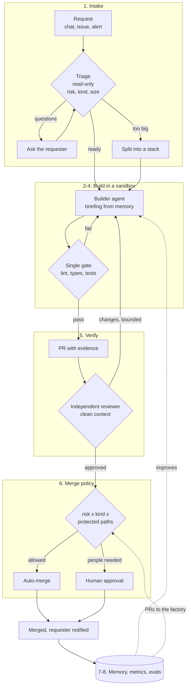

# The Software Factory Manifesto

> Trust comes from the environment, not from the model. Build the guardrails and the proof first,
> then hand over the work.

A **software factory** is a system in which AI agents take a request (a chat message, an issue,
an alert), build the change in an isolated environment, prove that it works, and get it merged
under a policy, with people deciding what to build and accepting the risk. This manifesto
collects what works, from ten talks by teams running factories and from our own reference
implementation, as rules that an agent can follow and a person can audit.

**For agents:** start at [`llms.txt`](llms.txt) or [`RULES.md`](RULES.md), and read
[`AGENTS.md`](AGENTS.md) for how to cite and apply this manifesto.

## The principles

1. **A deterministic spine moves the work.** Scripts and a state machine decide what happens next;
   models make judgment calls inside each stage. → [Deterministic spine](docs/02-deterministic-spine/README.md)
2. **Every correction becomes code.** Architecture, lint rules and types first; prose instructions
   last and short. → [Guardrails](docs/03-guardrails/README.md)
3. **Intake decides before anyone builds.** A read-only triage classifies risk, kind and size, and
   asks questions instead of guessing. → [Work intake](docs/01-work-intake/README.md)
4. **Every run is disposable and isolated.** The whole system runs inside the sandbox against
   mocks; secrets and production are out of reach. → [Sandboxes](docs/04-sandboxes/README.md)
5. **Review proof, not prose.** One gate, evidence in every PR, an independent reviewer, bounded
   rounds. → [Verification](docs/05-verification/README.md)
6. **Autonomy is a policy ceiling.** The strictest of risk, kind and protected paths decides who
   merges. → [Merge policy](docs/06-merge-policy/README.md)
7. **Agents start from memory and end by teaching it.** Scoped memory, briefings, learnings, a
   spec in the repo. → [Memory and context](docs/07-memory-and-context/README.md)
8. **The factory measures and improves itself.** Factory-as-code, recorded sessions, evals on
   your own work. → [Self-improvement](docs/08-self-improvement/README.md)
9. **Earn autonomy in order.** Guardrails, environments, pipeline, earned merge, self-improvement.
   → [Adoption](docs/09-adoption/README.md)

## The factory on one page

Every arrow above is executed by deterministic code; every diamond with a model behind it returns
structured data that code applies. A person can put any job on `hold` at any moment.

## Reading paths

| If you are | Read |
|---|---|
| An agent working inside a factory | [AGENTS.md](AGENTS.md), then the rules for your stage in [RULES.md](RULES.md) |
| Starting a factory | [Adoption](docs/09-adoption/README.md) → [Guardrails](docs/03-guardrails/README.md) → [Deterministic spine](docs/02-deterministic-spine/README.md) |
| Designing the pipeline | [Work intake](docs/01-work-intake/README.md) → [Job state machine](docs/02-deterministic-spine/job-state-machine.md) → [Request kinds](docs/01-work-intake/request-kinds.md) → [Merge policy](docs/06-merge-policy/README.md) |
| Responsible for quality | [Verification](docs/05-verification/README.md) → [Anti-patterns](docs/09-adoption/anti-patterns.md) → [Metrics](docs/08-self-improvement/metrics.md) |
| Responsible for security | [Deny rules and protected paths](docs/03-guardrails/deny-rules-and-protected-paths.md) → [Sandboxes](docs/04-sandboxes/README.md) → [Scoped memory](docs/07-memory-and-context/scoped-memory.md) |

## How this repository is organized

Three levels, each a link away from the next:

- **Level 0** — this page: the thesis, the principles, the map.
- **Level 1** — one page per theme in `docs/NN-theme/README.md`, with its rules and main diagram.
- **Level 2** — one page per subtopic in `docs/NN-theme/*.md`, with detailed rules, diagrams,
  anti-patterns and sources.

Every page has the same blocks in the same order (Rules, Diagram, Why or How to apply,
Anti-patterns, Sources, Go deeper, Up) and YAML front matter with `id`, `level`, `parent`,
`children`, `summary` and `prerequisites`. Rules have stable ids (`GR-03`) collected in
[RULES.md](RULES.md). Terms are defined in the [glossary](docs/reference/glossary.md); sources are
listed in [sources](docs/reference/sources.md); how we run it ourselves is in the
[reference implementation](docs/reference/reference-implementation.md).

## Keywords

**MUST**, **MUST NOT**, **SHOULD**, **SHOULD NOT** and **MAY** are used as in RFC 2119: MUST is a
requirement for a factory that follows this manifesto; SHOULD is a strong default you can depart
from with a recorded reason.

## License

[CC BY 4.0](LICENSE). Copy, adapt and build on it, with attribution.
