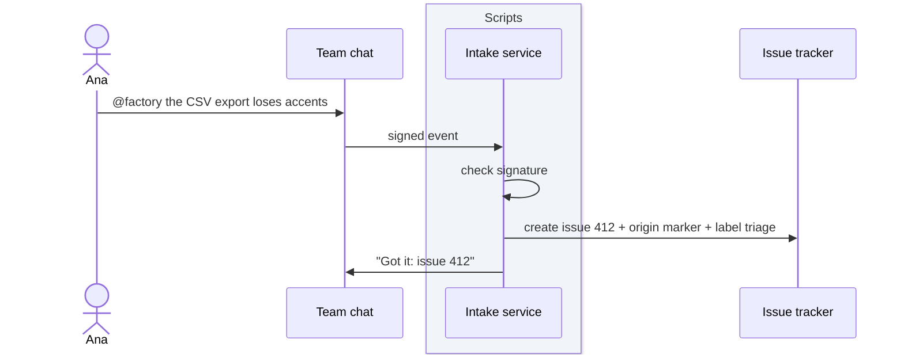

# Stage 1. The request arrives

> **In short:** Ana's message becomes a tracked issue in seconds, with a link back to her thread.
> Nothing is classified or built yet.

| | |
|---|---|
| **Who acts** | Ana (person), the intake service (script) |
| **Goes in** | A chat message that mentions `@factory` |
| **Comes out** | Issue 412, with a hidden link to Ana's thread and the label `triage` |
| **Job state** | none → `triage` |
| **Takes** | A few seconds |

## What happens

1. Ana writes her message in the team's request channel and mentions `@factory`.
2. The chat platform sends the event to the **intake service**, a small web service.
3. The intake service checks the event's signature. A fake or altered event is dropped here.
4. It creates issue 412 in the repository. The issue body has Ana's text and a hidden marker
   with the channel and thread id.
5. It adds the label `triage`, which starts the next stage, and asks the job script to create
   job 412 in the state `triage`.
6. It replies in Ana's thread with the issue link.

## What Ana sees

> **factory:** Got it. I opened issue 412 and I'll post updates in this thread.

## Why it works this way

- **Ana stays where she is.** She never opens a new tool. Every update comes back to her thread
  [S1][S9].
- **The intake service only records.** It doesn't decide risk or plan anything. That keeps it
  tiny, and keeps the judgment in the next stage, where a model can do it well.
- **The hidden marker** lets any later stage find Ana's thread from the issue alone.

## What can go wrong

| Problem | What the factory does |
|---|---|
| The signature is invalid | Drops the event. Nothing is created. |
| The chat platform sends the same event twice | The second one is ignored (see [stage 3](03-dispatch.md)). |
| Ana writes in a channel the factory doesn't watch | Nothing happens. The factory only picks up work that is opted in. |

## Go deeper

[Intake surfaces](../01-work-intake/intake-surfaces.md) · [Work intake](../01-work-intake/README.md)

## Next

[Stage 2. Triage](02-triage.md)

## Up

[The journey of a request](README.md)
