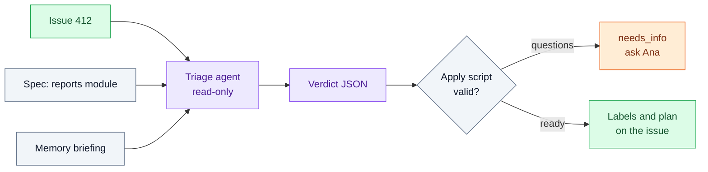

# Stage 2. Triage

> **In short:** an AI agent decides what this request is and how it should be built. A script,
> not the agent, writes that decision on the issue.

| | |
|---|---|
| **Who acts** | Triage agent (AI), apply script (script) |
| **Goes in** | Issue 412, the product spec, the code, a briefing from memory |
| **Comes out** | Labels `kind:bug` and `risk:low`, acceptance criteria and a plan on the issue |
| **Job state** | `triage` (or `needs_info` if there are questions) |
| **Takes** | One to three minutes |

## What happens

1. The `triage` label starts the **triage agent**. It can read, but it can't write anything.
2. It asks the factory's memory for a briefing: what earlier runs learned about the `reports`
   module.
3. It reads the spec for the `reports` module and the export code.
4. It returns a **verdict**, a small structured document (JSON), like the one below.
5. The **apply script** checks the verdict against a schema, then writes it on the issue: it
   rewrites the criteria and the plan, sets the labels, and adds the label `factory`, which
   means "ready to build".



## The verdict for Ana's request

```json
{
  "kind": "bug",
  "risk": "low",
  "size": "S",
  "module": "reports",
  "goal": "CSV exports keep accented characters when opened in spreadsheet apps.",
  "acceptance_criteria": [
    "Exporting a row with 'São Paulo' produces a file that shows 'São Paulo' in a spreadsheet app.",
    "A test reproduces the broken output on the current main branch."
  ],
  "out_of_scope": ["Other export formats (PDF, XLSX)."],
  "plan": ["Write a failing test with accented data.", "Fix the file encoding.", "Run the gate."],
  "affected_paths": ["reports/export/"],
  "questions": []
}
```

**Why `bug`?** Existing behavior is wrong. **Why `risk:low`?** The change is small, in one
module, and touches no sensitive area (no auth, no infrastructure, no data migration).

## Why it works this way

- **Decide before you build.** A few minutes here save hours of reviewing the wrong thing [S8].
- **The agent judges, the script writes.** If the verdict is malformed, the script refuses it.
  The agent can't skip steps or edit the issue its own way [S3].
- **Risk and kind decide the rest of the journey**: what the builder does first, what proof the
  reviewer wants, and who must approve the merge.

## What can go wrong

| Problem | What the factory does |
|---|---|
| Ana's message lacked detail ("exports are broken") | The verdict has questions. The job goes to `needs_info` and the questions appear in Ana's thread. Her answer restarts triage. |
| The request is too big for one run | Triage splits it into an ordered stack of small parts. |
| The verdict doesn't match the schema | The script refuses it and comments on the issue. Nothing is built. |

## Go deeper

[Triage and risk](../01-work-intake/triage-and-risk.md) · [Request kinds](../01-work-intake/request-kinds.md) · [Sizing and stacks](../01-work-intake/sizing-and-stacks.md)

## Next

[Stage 3. Dispatch](03-dispatch.md)

## Up

[The journey of a request](README.md)
