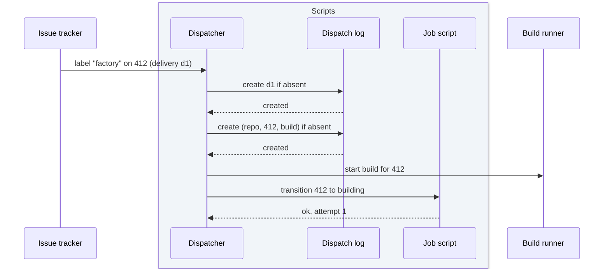

# Stage 3. Dispatch

> **In short:** a script starts exactly one build for issue 412, even if the trigger arrives
> twice, and records that the job is now `building`.

| | |
|---|---|
| **Who acts** | Dispatcher (script), job script (script) |
| **Goes in** | The event "issue 412 is ready to build" |
| **Comes out** | One build run, with its own id |
| **Job state** | `triage` → `building` (attempt 1) |
| **Takes** | Seconds |

## What happens

1. The label `factory`, added at the end of stage 2, means "ready to build".
2. The **dispatcher** receives the label event. Each event has a delivery id.
3. It writes the delivery id to a log, using "create only if absent". If the id is already
   there, the event is a duplicate and the dispatcher stops.
4. It also writes the key `(repository, 412, build)`. If a build for 412 is already running,
   it stops.
5. It starts the build run in a fresh environment.
6. It calls the **job script**, the only program allowed to change a job's state:
   `transition --issue 412 --to building`. The script checks the transition is allowed, adds it
   to the history and counts attempt 1.



## The job record after this stage

```yaml
issue: 412
kind: bug
risk: low
state: building
attempts: 1
history:
  - { state: triage,   at: "10:02:11Z", note: "created by intake" }
  - { state: building, at: "10:04:37Z", note: "dispatched build" }
```

## Why it works this way

- **Code decides what happens next, not a model.** Routing is a simple decision. Making it with
  an LLM costs tokens and is hard to test [S3][S6].
- **Events arrive twice.** Webhooks are redelivered and labels get re-applied. A duplicated build
  costs real money, so every stage checks before it starts [R].
- **One writer for the job state.** Agents never edit the job record. Only the job script does,
  and it rejects invalid transitions [S3].

## What can go wrong

| Problem | What the factory does |
|---|---|
| The same event arrives twice | The second one finds its delivery id in the log and stops. |
| The runner fails to start | The dispatcher returns an error, so the sender retries the event. |
| The job store is down | The job script logs a warning. The build still runs. |

## Go deeper

[Deterministic spine](../02-deterministic-spine/README.md) · [Idempotent dispatch](../02-deterministic-spine/idempotent-dispatch.md) · [Single writer](../02-deterministic-spine/single-writer.md) · [Job state machine](../02-deterministic-spine/job-state-machine.md)

## Next

[Stage 4. Build in a sandbox](04-build.md)

## Up

[The journey of a request](README.md)
