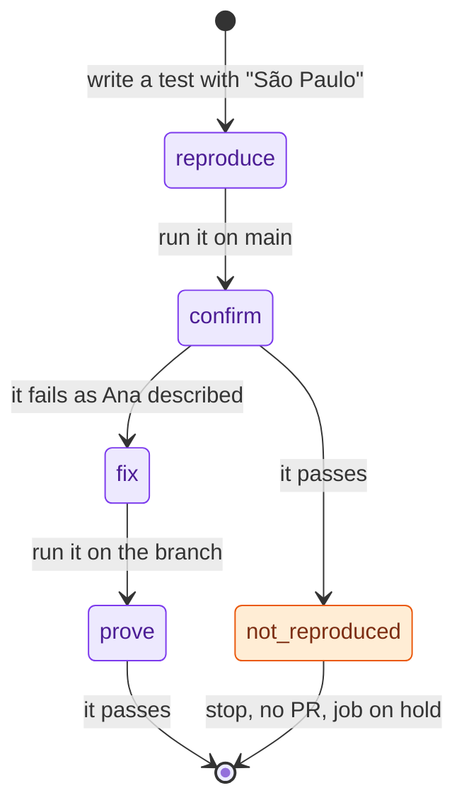

# Stage 4. Build in a sandbox

> **In short:** the builder proves the bug exists before it fixes anything. It works in a
> throwaway machine where it can run the whole app and can't reach anything real.

| | |
|---|---|
| **Who acts** | Builder agent (AI) |
| **Goes in** | Issue 412 with criteria and plan, a memory briefing, a fresh sandbox |
| **Comes out** | Branch `factory/issue-412` with a new test and a fix |
| **Job state** | `building` |
| **Takes** | Ten to thirty minutes, within a turn and time limit |

## What happens

1. A **sandbox** starts from the latest prepared image (a snapshot rebuilt regularly from `main`): the code, its dependencies, local
   databases and mocks of outside services. It has no secrets and no access to production.
2. The builder asks memory for a briefing. One learning says: "Spreadsheet apps need a UTF-8
   byte-order mark (BOM) to detect the encoding."
3. Because the kind is `bug`, the first step is fixed: **reproduce**. The builder writes a test
   that exports "São Paulo" and checks the bytes of the file.
4. It runs the test on `main`. The test **fails**, exactly as Ana described. The bug is proved.
5. It fixes the export to write UTF-8 with a BOM.
6. It runs the test again. It **passes**.
7. It commits to `factory/issue-412`. Small checks, called hooks, run after each edit (see
   [stage 5](05-gate.md)).

## Why it works this way

- **Prove, then fix.** A fix for a bug nobody reproduced is a guess. If the test doesn't fail on
  `main`, the builder stops, opens no PR and puts the job on `hold`. A person asks Ana for more
  detail [R]. It goes to `hold`, not `needs_info`, because the builder never talks to the
  requester directly. A person decides what to ask.
- **The whole app runs inside the sandbox.** An agent that can't run the software can't check
  its own work [S1][S2].
- **Nothing real is in reach.** No `.env` file, no personal keys, no production database. Deny
  rules in the harness (the program that runs the agent and its tools) block irreversible
  actions before they run [S7].
- **Hard limits.** The run has a maximum number of turns and minutes. A job that needs more is
  too big and should have been split in triage.

## What can go wrong

| Problem | What the factory does |
|---|---|
| The test passes on `main` (not reproduced) | No PR. Job → `hold` with the note "not reproduced". Ana is asked for details. |
| The builder hits its turn or time limit | The run ends. Job → `failed`, and Ana's thread gets the log link. |
| The builder tries to read a secret | The harness blocks it before it runs. |

## Go deeper

[Sandboxes](../04-sandboxes/README.md) · [Local with mocks](../04-sandboxes/local-with-mocks.md) · [Request kinds](../01-work-intake/request-kinds.md) · [Deny rules](../03-guardrails/deny-rules-and-protected-paths.md) · [Briefing and reflection](../07-memory-and-context/briefing-and-reflection.md)

## Next

[Stage 5. The gate](05-gate.md)

## Up

[The journey of a request](README.md)
