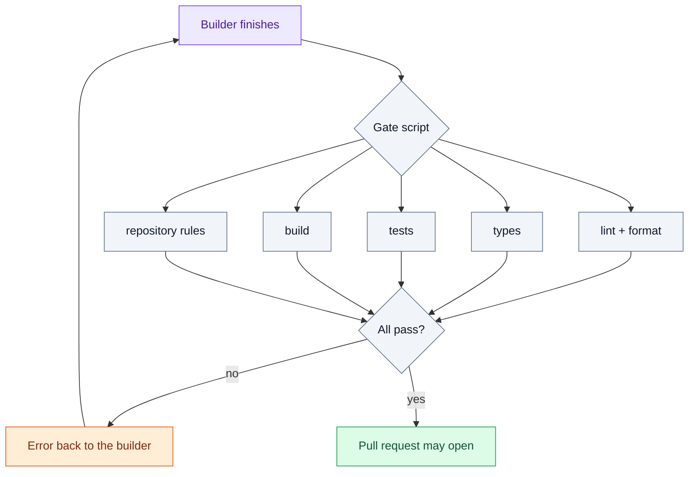

# Stage 5. The gate

> **In short:** one script decides whether the work is good enough to show anyone. If it fails,
> there is no pull request.

| | |
|---|---|
| **Who acts** | Gate script (script), builder agent (fixes what fails) |
| **Goes in** | Branch `factory/issue-412` |
| **Comes out** | Pass, or fail with a log |
| **Job state** | `building` (or `failed` if it can't pass) |
| **Takes** | A few minutes |

## What happens

1. While the builder edits, a **hook** runs the fast part of the gate (lint and format) after
   each change. Problems are fixed while the context is fresh.
2. When the builder is done, the full gate runs: lint, format, type check, all tests, build and
   repository rules (for example "one app never imports another").
3. In Ana's case, the type check fails once: the new helper is missing a return type.
4. The gate sends the error back to the builder, which is still running. The builder adds the
   type, and the gate passes.

## Why it works this way

- **One bar for everyone.** Hooks, CI and the factory run the same script. "Passes" means the
  same thing for an agent and for a person [S3][S7].
- **No PR while it fails.** In our experience, telling the builder "don't open a PR with failing
  checks" wasn't enough. Refusing to open the PR was [R].
- **Error messages teach.** Custom lint rules say what to do instead, so the builder fixes the
  cause rather than silencing the rule [S2].

## What can go wrong

| Problem | What the factory does |
|---|---|
| The gate still fails when the run ends | No PR. A comment on the issue with the log link. Job → `failed`. |
| A flaky test fails at random | The builder must not rerun until it passes. A person fixes or quarantines the test in a separate job, and the build waits for it. |
| The builder wants to disable a rule | It can't. It explains the conflict in the PR instead. |

## Go deeper

[Single gate](../05-verification/single-gate.md) · [Hooks](../05-verification/hooks.md) · [Lint rules that teach](../03-guardrails/teaching-lint-rules.md)

## Next

[Stage 6. Pull request with evidence](06-pull-request.md)

## Up

[The journey of a request](README.md)
