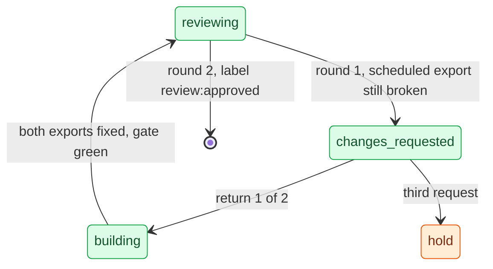

# Stage 7. Review

> **In short:** a second agent, which never saw the builder's reasoning, checks the work against
> the criteria. It can send the work back, but only a limited number of times.

| | |
|---|---|
| **Who acts** | Reviewer agent (AI), apply script (script), builder agent (fixes) |
| **Goes in** | The diff, the evidence, the acceptance criteria, the spec, the rules for `bug` |
| **Comes out** | `review:approved`, or `review:changes` with findings |
| **Job state** | `reviewing` → `changes_requested` → `building` → `reviewing` |
| **Takes** | A few minutes per round |

## What happens

1. The **reviewer agent** starts in a fresh session. Its model is at least as capable as the
   builder's.
2. It reads the diff, the verification section, the criteria from triage and the `reports` spec.
3. **Round 1.** It finds a gap. The `reports` spec says scheduled reports use the same CSV export,
   but the fix only covers the manual export. The scheduled export still loses accents. Its
   verdict lists the finding with file and line.
4. The review apply script applies the verdict: label `review:changes` and one comment. The job
   moves to `changes_requested`. The dispatcher starts a new build run for the same PR (the
   first run has ended, so it isn't a duplicate), and the job moves back to `building`
   (attempt 2).
5. The builder reads the finding, routes the scheduled export through the same fix, adds a test
   for it and pushes. The gate passes again, and the job moves back to `reviewing`.
6. **Round 2.** The reviewer approves. The label `review:approved` goes on the PR, and the job
   stays in `reviewing` until the merge decision.

## What the reviewer wrote

> **Changes requested (return 1 of 2)**
>
> - `reports/schedule/run.py:42`: scheduled reports write the CSV with `open()` directly, so they
>   still lose accents. The spec says scheduled reports use the same export. Route this through
>   the fixed writer and add a test for it.

## Why it works this way

- **A fresh pair of eyes.** The agent that wrote the code is the worst one to judge it. The
  reviewer starts clean and checks against the criteria, not against the builder's story.
- **Not a cheaper model.** A weaker reviewer nitpicks valid code and creates rework loops that
  cost more than they save [S3].
- **One reviewer, fed with the product spec.** Several models arguing with each other burn huge
  token budgets and drift from what the product needs [S2].
- **Bounded returns.** The builder gets the work back at most twice. A third request for
  changes puts the job on `hold`. Without a limit, borderline findings loop
  forever [R].

## What can go wrong

| Problem | What the factory does |
|---|---|
| The reviewer asks for changes a third time | Job → `hold`. A comment explains why, and Ana's thread is told. |
| The builder disagrees with a finding | It replies with its reason in the PR. It never ignores a finding silently. |

## Go deeper

[Independent reviewer](../05-verification/independent-reviewer.md) · [Return loop](../05-verification/return-loop.md)

## Next

[Stage 8. Merge decision](08-merge.md)

## Up

[The journey of a request](README.md)
