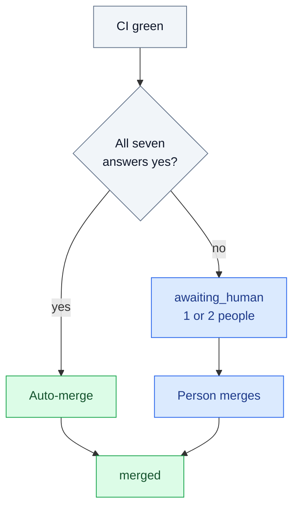

# Stage 8. Merge decision

> **In short:** no agent decides to merge. A script checks a fixed list of conditions. Ana's
> low-risk bug fix passes all of them, so it merges on its own.

| | |
|---|---|
| **Who acts** | Merge script (script) |
| **Goes in** | The PR's labels, changed paths, CI status and review verdict |
| **Comes out** | A squash merge, or a request for people to approve |
| **Job state** | `reviewing` → `merged` (or `awaiting_human`) |
| **Takes** | Seconds after CI turns green |

## What happens

When CI turns green, the merge script answers seven questions. Every answer must be "yes" for an
automatic merge.

| # | Question | Ana's PR |
|---|---|---|
| 1 | Was the PR made by the factory, on a `factory/` branch? | Yes |
| 2 | Is the risk in the auto-merge list (`risk:low`)? | Yes |
| 3 | Does the kind allow auto-merge? (`feature` and `incident` never do) | Yes, `bug` |
| 4 | Did the reviewer approve, with no open change request? | Yes, round 2 |
| 5 | Are all changed files outside protected paths? | Yes, only `reports/` |
| 6 | Is there no `hold` label? | Yes |
| 7 | Did CI pass on the latest commit? | Yes |

All yes, so the script squash-merges the PR (all its commits become one commit on `main`) and the job script moves the job to `merged`.

## When a person is needed

The strictest rule wins. Risk sets a number of approvals (low 0, medium 1, high 2). Kind sets a
minimum (feature 1, incident 1). Protected paths always need a person.

| Same fix, but… | Result |
|---|---|
| …`risk:medium` | One person approves and merges it |
| …it also changed the CI workflow | A person merges (protected path) |
| …it was a `feature` | One person approves, even at `risk:low` |
| …someone added `hold` | Nothing happens until a person removes it |

## Why it works this way

- **Autonomy is a policy, not a feeling.** The rules live in one versioned file. Anyone can read
  why a PR did or didn't merge.
- **Autonomy is earned.** Teams start with people merging everything, then turn on auto-merge
  for low-risk kinds once revert rates stay low [S7][S8].

## What can go wrong

| Problem | What the factory does |
|---|---|
| A condition fails | The PR waits in `awaiting_human`. The reason is shown on the PR. |
| Someone pushes to the PR after CI | The script waits for CI on the new commit. |

## Go deeper

[Merge policy](../06-merge-policy/README.md) · [Risk × kind](../06-merge-policy/risk-times-kind.md) · [Human review and hold](../06-merge-policy/human-review-and-hold.md)

## Next

[Stage 9. Notify and learn](09-notify-and-learn.md)

## Up

[The journey of a request](README.md)
