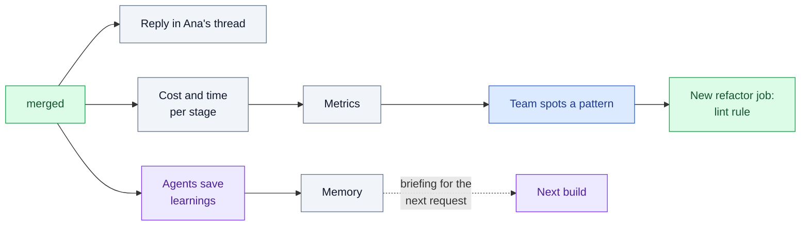

# Stage 9. Notify and learn

> **In short:** Ana hears back where she asked. The factory records what the job cost and what
> the agents learned, so the next request goes better.

| | |
|---|---|
| **Who acts** | Notify script and job script (scripts), the agents (save learnings), the team (people, later) |
| **Goes in** | The merged PR and the job record |
| **Comes out** | A reply to Ana, metrics, learnings, maybe a new improvement job |
| **Job state** | `merged` (final) |
| **Takes** | Seconds; the learning pays off later |

## What happens

1. The notify script replies in Ana's thread with the PR link.
2. The job script records cost and duration for each stage.
3. Each agent ends its run by saving an outcome and a few **learnings** to memory. A learning is
   a short fact that helps a future run on a different task.
4. Metrics update: lead time, cost per PR, review rounds, share of PRs with evidence.
5. The team notices this was the third encoding bug this year. They open a `refactor` job: a lint
   rule that forces every CSV through one helper. The same mistake can't come back.

## What Ana sees

> **factory:** Merged: "Fix: CSV export keeps accented characters". It goes out with the next
> release. 2 review rounds, 41 minutes.

## What the builder saved to memory

> In the `reports` module, CSV files must be written with UTF-8 and a byte-order mark, or
> spreadsheet apps show accented characters wrongly.

## The whole journey, in numbers

| | |
|---|---|
| People needed to approve or merge | 0 (only Ana, who asked) |
| Stages | 9 |
| Build attempts | 2 (one return from review) |
| Job states | `triage` → `building` → `reviewing` → `changes_requested` → `building` → `reviewing` → `merged` |

The numbers are an example, not a benchmark.

## Why it works this way

- **Close the loop where it started.** The person who asked shouldn't have to check a dashboard.
- **Record everything.** Sessions, costs and outcomes are the raw material for improving the
  factory [S4][S5].
- **Learnings graduate into code.** A fact that keeps coming back becomes a check, so it stops
  depending on memory at all [S2].

## Go deeper

[Self-improvement](../08-self-improvement/README.md) · [Metrics](../08-self-improvement/metrics.md) · [Memory and context](../07-memory-and-context/README.md) · [Lint rules that teach](../03-guardrails/teaching-lint-rules.md)

## Next

See how the journey changes for [a feature](feature.md) and [an incident](incident.md).

## Up

[The journey of a request](README.md)
