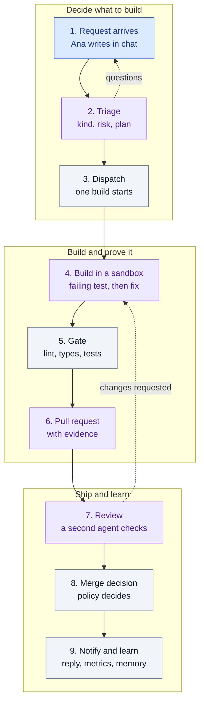

# The journey of a request

> **In short:** follow one bug report from a chat message to a merged fix. Nine stages, about
> forty minutes, and no person needed after the one who asked.

This section is a story. It shows the whole factory working on one request, so you can see how
the parts fit before you read about each part.

## The request

Ana is a support engineer. A customer complained that city names look broken in exported
reports. Ana writes in the team chat:

> **Ana:** @factory the CSV export loses accents. "São Paulo" comes out as "São Paulo".

That's all she does. Everything below happens because of this one message.

## Who's who

Three kinds of actors take part, plus two colors for where the job is. The diagrams use the
same colors on every page.

| Color | Actor | In this story |
|---|---|---|
| Blue | **Person** | Ana, who asks. A reviewer, if the policy needs one. |
| Gray | **Script** | Code with no AI: the intake service, the dispatcher, the gate, the merge script. It makes the same decision every time. |
| Purple | **AI agent** | The triage agent, the builder and the reviewer. They make judgment calls inside a stage. |
| Green | **Job state** | Where the request is, recorded by one script: `triage`, `building`, `reviewing`, `merged`… |
| Orange | **Stop** | A failure or a hold that waits for a person. |

## The map

The diagram shows the nine stages in three phases: decide, build and prove, ship and learn. On
the website, each box links to its page.

## The stages at a glance

| # | Stage | Who acts | What comes out | Job state after |
|---|---|---|---|---|
| 1 | [The request arrives](01-request-arrives.md) | Ana, intake service | Issue 412, linked to Ana's thread | `triage` |
| 2 | [Triage](02-triage.md) | Triage agent, apply script | Risk, kind, criteria and plan on the issue | `triage` |
| 3 | [Dispatch](03-dispatch.md) | Dispatcher, job script | One build run started | `building` |
| 4 | [Build in a sandbox](04-build.md) | Builder agent | A failing test, then a fix, on branch `factory/issue-412` | `building` |
| 5 | [The gate](05-gate.md) | Gate script | Pass or fail, with the log | `building` |
| 6 | [Pull request with evidence](06-pull-request.md) | Builder agent, PR script | A PR with before/after proof | `reviewing` |
| 7 | [Review](07-review.md) | Reviewer agent | Approve, or changes with findings | `reviewing` or `changes_requested` |
| 8 | [Merge decision](08-merge.md) | Merge script | Auto-merge, or a request for people | `merged` or `awaiting_human` |
| 9 | [Notify and learn](09-notify-and-learn.md) | Notify script, memory | A reply to Ana, metrics, learnings | `merged` |

## The same journey for other kinds of work

The stages don't change for other work. What changes is what goes in, what proof comes out and
who must approve.

- [A feature](feature.md): "add a date filter to the CSV export". Triage asks a question, and a
  person always approves.
- [An incident](incident.md): "the export endpoint returns 500 since the last release". It starts
  from an alert, and the on-call person merges.

Two more things help you read the stages:

- **Labels and states are different.** Labels on the issue (`triage`, `factory`,
  `review:approved`, `hold`) are how scripts signal each other. The **job state** is the
  record that the job script keeps. Some share a name, like `triage` and `hold`.
- **Tags like [S1] or [R]** point to the talk the practice comes from, listed in
  [sources](../reference/sources.md). [R] means our own experience.

> [!TIP]
> Short on time? Read stages 2, 4 and 8. They hold the three most important ideas: decide before
> building, prove before claiming, and let policy decide the merge.

## Up

[Manifesto](../../README.md)
