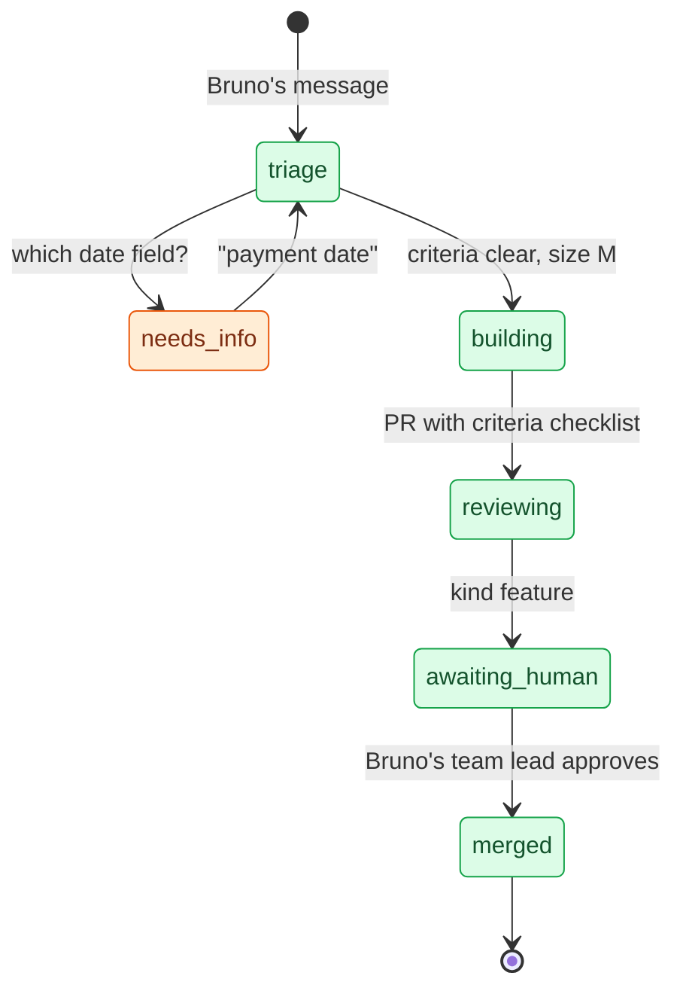

# The journey of a feature

> **In short:** same nine stages. The differences are more care before the code, one test per
> criterion, and a person who always approves.

Bruno, a product manager, writes:

> **Bruno:** @factory add a date filter to the CSV export.

## Where it differs from the bug

| Stage | Bug (Ana) | Feature (Bruno) |
|---|---|---|
| 2. Triage | Ready at once | **Asks a question:** "Filter by order date or payment date?" Job → `needs_info` until Bruno answers. |
| 2. Triage | Size S | Size M. A larger request would be split into a stack: small parts built one after another. |
| 4. Build | First step: a failing test | First step: **map each criterion to a test** |
| 6. Evidence | Before/after test output | A checklist, criterion → test or screenshot |
| 8. Merge | Auto-merge | **Always a person**, even at `risk:low` |

## The flow

The diagram shows the job states for Bruno's request. Note the loop through `needs_info`.

## The acceptance criteria after Bruno's answer

1. The export page has "From" and "To" fields for the payment date.
2. Only rows with a payment date inside the range are exported, both ends included.
3. Leaving both fields empty exports all rows, as today.

Each criterion gets its own test. The PR shows a screenshot of the new fields.

## Why a person always approves

A feature changes what users see. It's the kind of work where the factory most often builds the
wrong thing, even when the code is correct. A person checks the result against the intent,
starting from the evidence, not the diff. User-visible changes go out behind a flag when the
product has flags [S8][S9].

> [!TIP]
> Spend the effort before the code. A clear question in triage costs Bruno ten seconds. A wrong
> guess costs a full build and review.

## Go deeper

[Request kinds](../01-work-intake/request-kinds.md) · [Sizing and stacks](../01-work-intake/sizing-and-stacks.md) · [Risk × kind](../06-merge-policy/risk-times-kind.md)

## Up

[The journey of a request](README.md)
