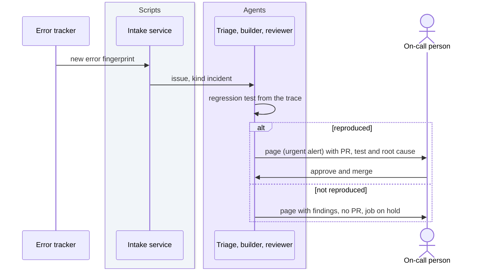

# The journey of an incident

> **In short:** an alert, not a person, starts the job. The factory races to a candidate fix.
> The on-call person decides.

At 03:10 the error tracker fires:

> **Alert:** `GET /reports/export` returns 500 since release 2.14. 230 errors in 10 minutes.

## Where it differs from the bug

| Stage | Bug (Ana) | Incident (alert) |
|---|---|---|
| 1. Arrives | Ana's chat message | **An alert**, labeled `source:alerts`. One job per distinct error. |
| 2. Triage | Needs what Ana gave: what's wrong and an example | Needs the alert link, the release and the error trace |
| 4. Build | Reproduce, then fix | Turn the error trace into a **regression test**, write a short **root-cause note**, then fix |
| 8. Merge | Auto-merge | **Never automatic.** The on-call person approves and merges. |
| Watching | Normal | If the job sits in one state for more than about 30 minutes, an alert goes to the operations channel |

## The flow

The sequence shows the night of the incident. The gate and the review still run as for the
bug; they are left out to keep the diagram short.

## What the on-call person gets

> **Root cause:** release 2.14 renamed the column `paid_at` to `payment_date`. The export query
> still selects `paid_at`.
>
> **Fix:** select `payment_date`. **Regression test:** `test_export_after_column_rename`, fails on
> 2.14, passes on this branch.

## Why a person always merges

The value here is speed to a proposal, not autonomy. Even if only half the candidate fixes are
right, on-call work changes from "start investigating at 3 a.m." to "evaluate a proposal" [S8].
None of the sources argues for merging incident fixes without a person.

> [!WARNING]
> If the error can't be reproduced, the factory sends findings and opens no PR. A speculative fix
> during an incident can make things worse.

## Go deeper

[Incidents](../06-merge-policy/incidents.md) · [Request kinds](../01-work-intake/request-kinds.md) · [Failure handling](../02-deterministic-spine/failure-handling.md)

## Up

[The journey of a request](README.md)
