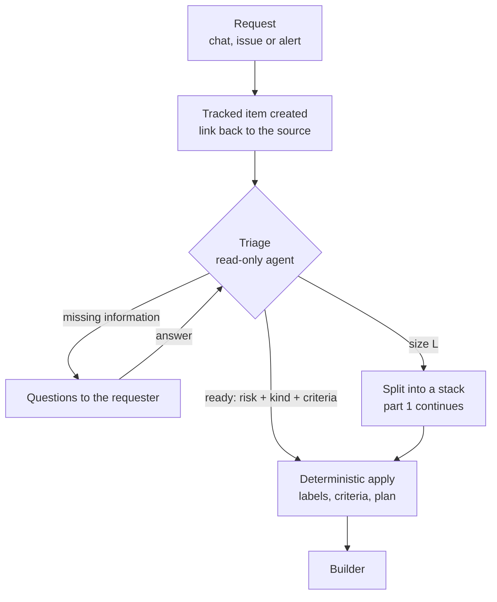

# 01. Work intake

> Work enters where people already talk, a read-only triage step classifies it, and only a
> well-formed, small, explicitly accepted job reaches a builder.

Most failed agent runs fail before the first line of code: the request was vague, too big, or
the wrong kind of work for automation. Intake is where the factory decides what to build, how
much autonomy it gets, and what proof it must bring back.

## Rules

- **IN-01** Work MUST enter through the tools the team already uses (chat, issue tracker, alerts),
  and every request MUST become a tracked item with a link back to where it came from.
- **IN-02** Every request MUST pass a triage step before any builder runs. Triage MUST be
  read-only.
- **IN-03** Triage MUST output structured data (risk, kind, size, acceptance criteria, questions),
  and a deterministic script, not the triage agent, MUST apply it.
- **IN-04** A request with missing information MUST go back to the requester as questions, not
  forward to a builder with guesses.
- **IN-05** The factory MUST only pick up work that was explicitly opted in (a label, a command,
  a channel).
- **IN-06** A request too large for one bounded run MUST be split into an ordered stack of small
  parts.

## Diagram

## Why

- Planning is cheaper than review. Twenty to thirty minutes of alignment before building saves
  hours of reviewing the wrong thing [S8].
- A strong model at intake can reject, scope and classify risk, and that classification later
  decides who reviews and whether merge can be automatic [S3].
- People do not open a new tool to ask for work. Teams that reached high volume run the whole
  loop from chat, down to sending the fix back to the customer [S1][S9].

## Anti-patterns

- A builder that receives a one-line request and invents the acceptance criteria.
- Triage that edits the repository or the issue directly instead of returning data.
- Every message in a busy channel becoming a job without an explicit opt-in.
- One job per epic. Long runs drift, and nobody can review the result.

## Sources

[S1] [S3] [S8] [S9] [R]

## Go deeper

1. [Intake surfaces](intake-surfaces.md): chat, issues and alerts as entry points, and the link back.
2. [Triage and risk](triage-and-risk.md): what triage outputs and how risk is assigned.
3. [Request kinds](request-kinds.md): bug, feature, incident, docs, refactor, chore, each with its own flow.
4. [Sizing and stacks](sizing-and-stacks.md): splitting large work into ordered parts.

## Up

[Manifesto](../../README.md)
