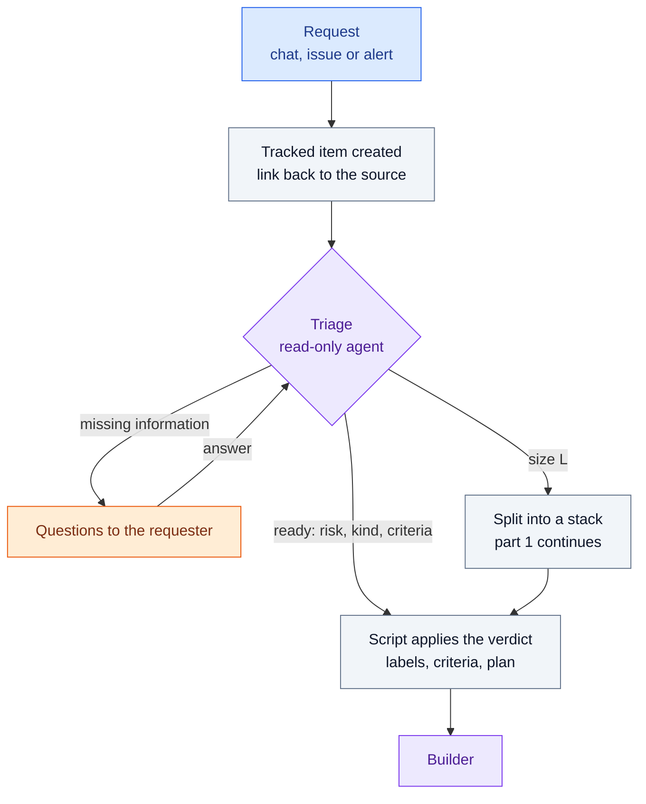

# 01. Work intake

> **In short:** take work where people already ask for it. Let a read-only agent classify it,
> and send only small, clear jobs to a builder.

## The problem

Most failed agent runs fail before the first line of code. The request was vague, too big, or
the wrong kind of work for automation. A builder that gets a one-line request invents its own
acceptance criteria, and nobody can check the result against anything.

Planning is cheaper than review. One speaker says twenty to thirty minutes of alignment before
building saves hours of reviewing the wrong thing [S8].

People also don't open a new tool to ask for work. Teams that reached high volume run the whole
loop from chat, down to sending the fix back to the customer [S1][S9].

## How it works

Intake is where the factory decides what to build, how much autonomy the job gets, and what proof
it must bring back.

1. **A person asks where they already work**: the team chat, the issue tracker, or an alert. The
   factory only picks up work that was opted in with a label, a command or a channel.
2. **Intake records the request** as a tracked item, with a link back to where it came from.
3. **A read-only agent classifies it.** This step is [triage](../reference/glossary.md). It reads
   the request, the spec and the code, and returns data: risk, kind, size, acceptance criteria
   and questions.
4. **A script applies the verdict.** Missing information goes back to the requester as questions.
   A request that is too big becomes a [stack](../reference/glossary.md) of small parts.
5. **A ready job goes to the builder.**

A strong model at intake can reject, scope and classify risk. That classification later decides
who reviews and whether the merge can be automatic [S3].

The diagram shows the path from a request to the builder.

## Example

Ana, a support engineer, writes in the team chat: "@factory the CSV export loses accents. 'São
Paulo' comes out as 'São Paulo'." The chat channel is opted in, so intake creates issue 412 with
a link back to her thread.

Triage reads the `reports` module and the spec. It returns `kind: bug`, `risk: low`, `size: S` and
one verifiable criterion: an exported "São Paulo" opens as "São Paulo" in a spreadsheet app. It
has no questions. A script applies the labels, and the builder starts on `factory/issue-412`.

> [!WARNING]
> **One job per epic.** Long runs drift, and nobody can review the result. Split the work into a
> stack instead.

> [!WARNING]
> **Triage that acts.** A triage agent that edits the repository or the issue mixes judgment with
> action. It should return data and let a script apply it.

## In this section

| Page | Read it to learn |
|---|---|
| [Intake surfaces](intake-surfaces.md) | How chat, issues and alerts become one kind of tracked item, linked to its thread |
| [Triage and risk](triage-and-risk.md) | What triage returns, and how risk is set |
| [Request kinds](request-kinds.md) | How the six kinds change the evidence and the merge, without new states |
| [Sizing and stacks](sizing-and-stacks.md) | How to split large work into small ordered parts |

## Checklist

- **IN-01** Work MUST enter through the tools the team already uses (chat, issue tracker, alerts),
  and every request MUST become a tracked item with a link back to where it came from.
- **IN-02** Every request MUST pass a triage step before any builder runs. Triage MUST be
  read-only.
- **IN-03** Triage MUST return structured data (risk, kind, size, acceptance criteria, questions),
  and a deterministic script, not the triage agent, MUST apply it.
- **IN-04** A request with missing information MUST go back to the requester as questions, not
  forward to a builder with guesses.
- **IN-05** The factory MUST only pick up work that was explicitly opted in (a label, a command,
  a channel).
- **IN-06** A request too large for one bounded run MUST be split into an ordered stack of small
  parts.

## Sources

[S1] [S3] [S8] [S9] [R]

## Up

[Manifesto](../../README.md)
