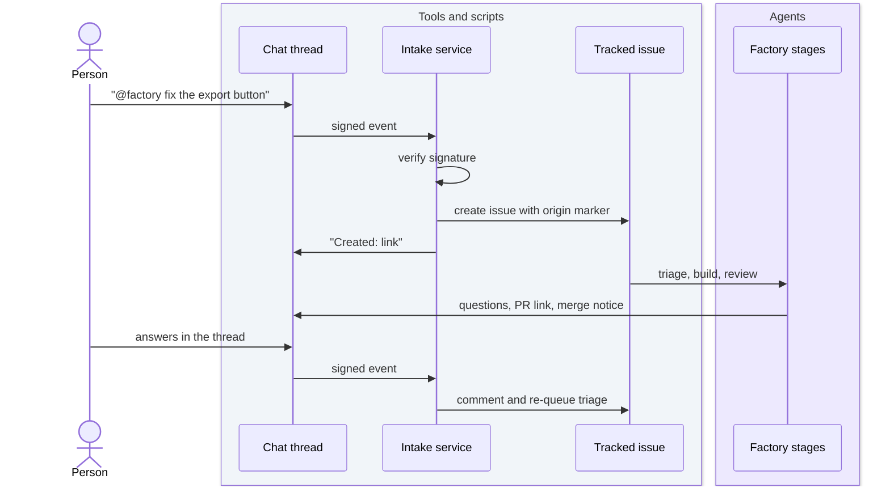

# Intake surfaces

> **In short:** accept work where people already discuss it, and keep one thread per request from
> the first message to the merge notice.

## The problem

A separate portal for requests is one more thing people must remember to open. Most won't, and
the work reaches the team some other way, out of the factory's sight.

The opposite failure is losing the thread. The pull request lands, and the person who asked never
hears about it.

## How it works

An intake surface is any place a request can start: a chat thread, an issue, an alert. Intake
only records and routes. It doesn't classify, plan or build.

1. **A request arrives.** Someone mentions the factory in chat, opens an issue, or an alert fires.
2. **Intake checks that the event is real.** It verifies the request signature or the webhook
   secret before it creates anything.
3. **Intake creates a tracked item.** Every surface creates the same kind of item, so nothing
   after intake cares where the request came from.
4. **The item stores its origin.** A machine-readable link, such as a hidden marker with the
   thread id, lives inside the item itself. Any stage can find the thread from it.
5. **The factory reports back on the origin thread**: the item link, questions, the PR link and
   the merge notice.
6. **Replies flow back.** When the requester answers in the thread, intake adds the answer to the
   item and triage runs again.

The item also records its **source** (chat, alert, customer feedback), apart from its
[kind](request-kinds.md). Source says where a request came from. Kind says what it is. An alert
can carry a bug, and a chat message can carry a feature.

The diagram shows one request and one answer, end to end.

Keep the intake service tiny and stateless: verify, create, reply. It should be boring enough that
nobody needs to touch it after the first week. Offer a read-only status command on the same
surface. It shows the state, the time in that state, the PR and the cost.

## Example

Ana's message reaches intake as a signed event. Intake verifies the signature and creates issue
412. The issue holds a hidden marker that points to her thread, and the label `source:chat`.
Intake replies in her thread with the issue link.

Ana never opens the tracker. If triage had a question, it would appear in her thread, and her
answer would go back to issue 412. When the fix merges, the notice lands in the same thread.

> [!TIP]
> Start with one surface, usually chat, and one repository. Add alerts and customer feedback later
> as new producers of the same tracked item, each with its own `source:*` label.

> [!WARNING]
> **One job per alert.** An alert that fires a hundred times shouldn't create a hundred jobs.
> Create one job per distinct error.

## Checklist

- **IN-07** Each surface (chat, issue tracker, alerting) MUST create the same kind of tracked
  item, so everything after intake works the same whatever the surface.
- **IN-08** The tracked item MUST carry a machine-readable link to its origin (for example a
  hidden marker with the thread id), and the factory MUST post status back to that origin.
- **IN-09** Intake MUST verify that every inbound event is authentic (request signatures, webhook
  secrets) before creating anything.
- **IN-10** Intake MUST NOT classify, plan or build. It records and routes.
- **IN-11** Replies from the requester on the origin thread SHOULD flow back into the tracked
  item automatically, so answering a question needs no switch of tools.
- **IN-12** The source of a request (chat, alert, customer feedback) MUST be recorded separately
  from its kind. Source says where it came from; kind says what it is.

## Sources

[S1] [S4] [S9] [R]

## Up

[01. Work intake](README.md)
