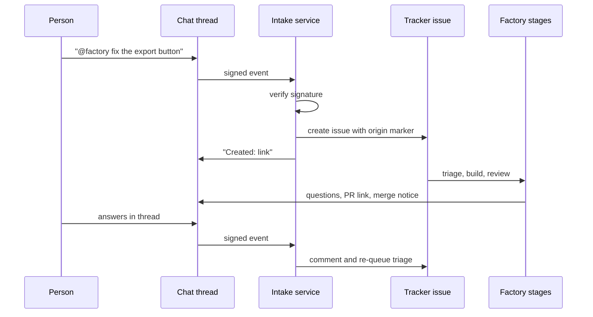

# Intake surfaces

> Accept work where it is already being discussed, and keep one thread per request from the
> first message to the merge notice.

## Rules

- **IN-07** Each surface (chat, issue tracker, alerting) MUST create the same kind of tracked
  item, so everything after intake is surface-agnostic.
- **IN-08** The tracked item MUST carry a machine-readable link to its origin (for example a
  hidden marker with channel and thread id), and the factory MUST post status back to that origin.
- **IN-09** Intake MUST verify the authenticity of every inbound event (request signatures,
  webhook secrets) before creating anything.
- **IN-10** Intake MUST NOT classify, plan or build. It records and routes.
- **IN-11** Replies from the requester on the origin thread SHOULD flow back into the tracked
  item automatically, so answering a question needs no context switch.
- **IN-12** The source of a request (chat, alert, customer feedback) MUST be recorded separately
  from its kind. Source says where it came from; kind says what it is.

## Diagram

## How to apply

1. Start with one surface (usually chat) and one repository.
2. Keep the intake service tiny and stateless: verify, create, reply. It should be boring enough
   that nobody needs to touch it after week one.
3. Store the origin link inside the tracked item itself, not in a side database, so any stage
   can find the thread.
4. Add alert and feedback surfaces later as new producers of the same tracked item, with a
   `source:*` label.
5. Offer a read-only status command on the same surface (state, time in state, PR, cost).

## Anti-patterns

- A separate portal that people have to remember to open.
- Losing the thread: the PR lands, and the person who asked never hears about it.
- Alerts that create a job per occurrence instead of one job per distinct error.

## Sources

[S1] [S4] [S9] [R]

## Up

[01. Work intake](README.md)
