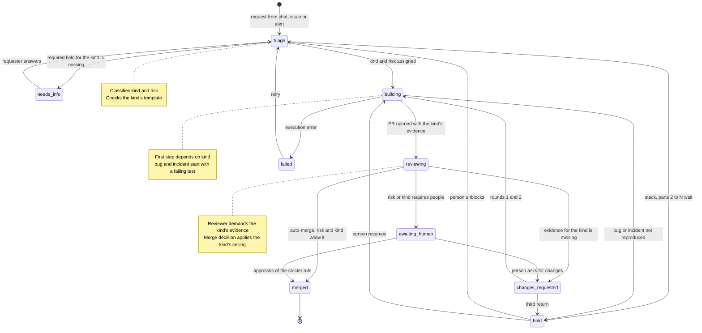
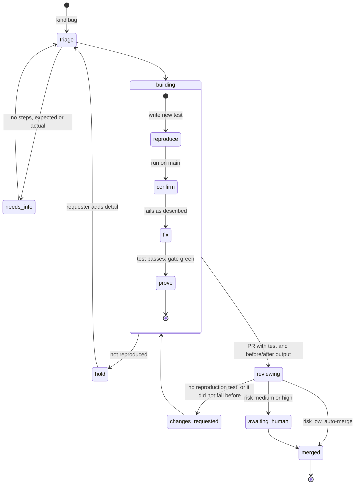
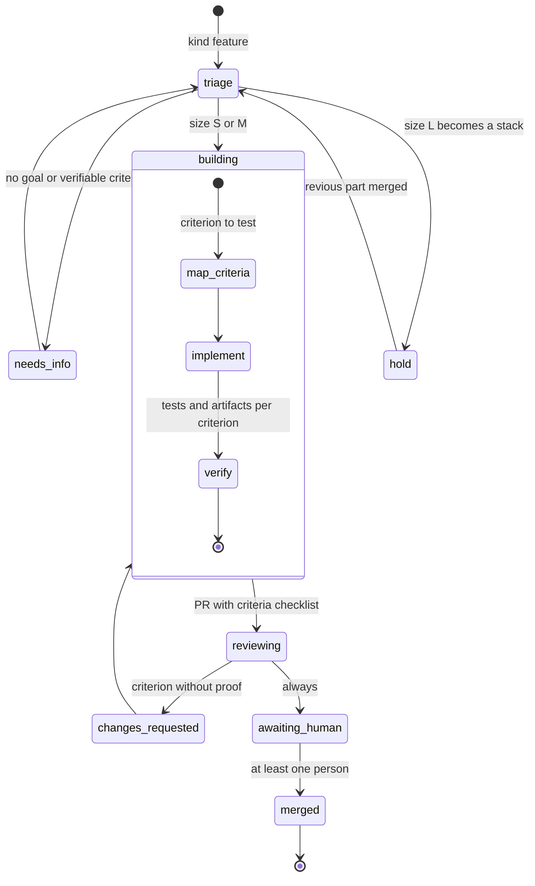
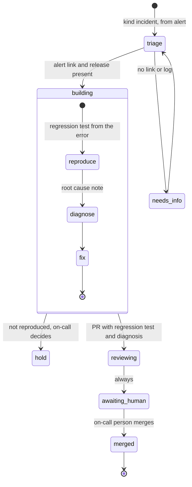
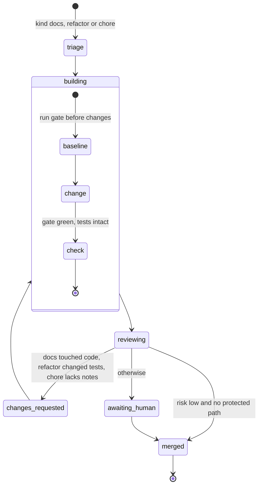

# Request kinds

> One pipeline, six kinds. The kind does not add states; it changes what goes in, what the builder
> does first, what proof comes out, and how much autonomy the merge gets.

None of the sources runs a separate pipeline per kind of work. They all use one skeleton (intake,
triage with risk, spec or reproduction, isolated build, deterministic gate, review, merge) and
vary only the evidence and the degree of autonomy [S1][S3][S7][S8][S9].

## Rules

- **IN-19** Triage MUST assign exactly one kind: `bug`, `feature`, `incident`, `docs`, `refactor`
  or `chore`.
- **IN-20** When unsure between two kinds, triage MUST pick the more restrictive one. A bug fix
  that needs new behavior is a `feature`.
- **IN-21** An item with no kind MUST be treated as `feature`.
- **IN-22** Kind MUST NOT add states to the job state machine. It parameterizes the existing
  stages.
- **IN-23** The effective merge ceiling MUST be the most restrictive of risk, kind and protected
  paths (see [Risk × kind](../06-merge-policy/risk-times-kind.md)).
- **IN-24** A `bug` or `incident` that the builder cannot reproduce MUST stop with no PR and go to
  `hold` with a "not reproduced" note.

## The six kinds

| Kind | When | Request must contain | Builder's first step | Evidence in the PR | Merge ceiling | Minimum people |
|---|---|---|---|---|---|---|
| `bug` | Existing behavior is wrong | Steps to reproduce, expected vs actual, where | Write a test that reproduces the failure and see it fail on main | Test fails on main, passes on branch; screenshot or video if visual | Auto-merge if `risk:low` | 0 |
| `feature` | New behavior, or a change users can see | Goal, who uses it, verifiable acceptance criteria | Map each criterion to a test or check | Checklist: criterion → test or artifact | Never auto-merge | 1 |
| `incident` | Production error (alert, error tracker, urgent report) | Alert or log link, release, frequency | Regression test that reproduces the error; root-cause note | Regression test + diagnosis | Never auto-merge | 1 (on call) |
| `docs` | Documentation, text or copy only | What changes and why | Edit | Diff touches documentation paths only | Auto-merge if `risk:low` and no protected path | 0 |
| `refactor` | Internal improvement with no behavior change, including new lint rules | What improves and why | Run existing tests before touching code | Existing tests unchanged (only additions allowed) | Auto-merge if `risk:low` | 0 |
| `chore` | Dependencies, CI, build, configuration | What to update, to which version | Read the release notes | Gate green; release notes in the PR | Auto-merge if `risk:low` | 0 |

Goal-oriented work ("bring p99 latency under 200 ms", "keep Android at parity with iOS") is not a
kind. It is a long-running objective that spawns jobs of these kinds, and it needs evals and
measurement first [S1]. See [Self-improvement](../08-self-improvement/README.md).

## Overview: where kind acts on the state machine

## `bug`: prove it, then fix it

## `feature`: invest before the code

User-visible changes should ship behind a flag where the product has flags, and go through
internal dogfooding before general release [S8][S9].

## `incident`: the page arrives with a PR

The value is speed to a candidate fix, not autonomy: even a fix that is right half the time
changes the on-call experience [S8]. No source argues for merging incident fixes without a person.
An incident job stuck in one state for more than a short, configured time SHOULD alert.

## `docs`, `refactor` and `chore`: autonomy earned by static checks

Small text changes need no person after checks [S7]. A pattern fixed by hand twice SHOULD become a
lint rule through a `refactor` job [S2].

## Anti-patterns

- A separate pipeline, prompt set and dashboard per kind. It multiplies maintenance and hides the
  shared spine.
- Treating the source as the kind ("it came from the error tracker, so it is an incident").
- A "fix" for a bug that was never reproduced.

## Sources

[S1] [S2] [S3] [S7] [S8] [S9] [R]

## Up

[01. Work intake](README.md)
