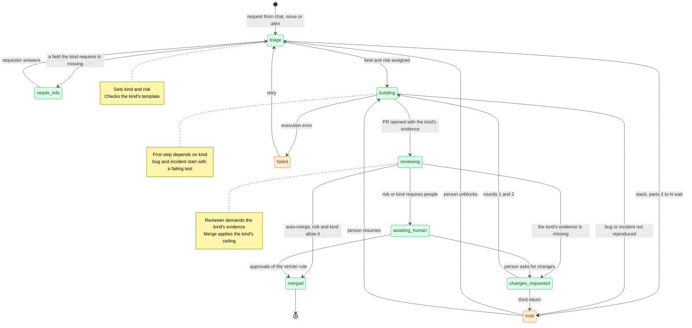
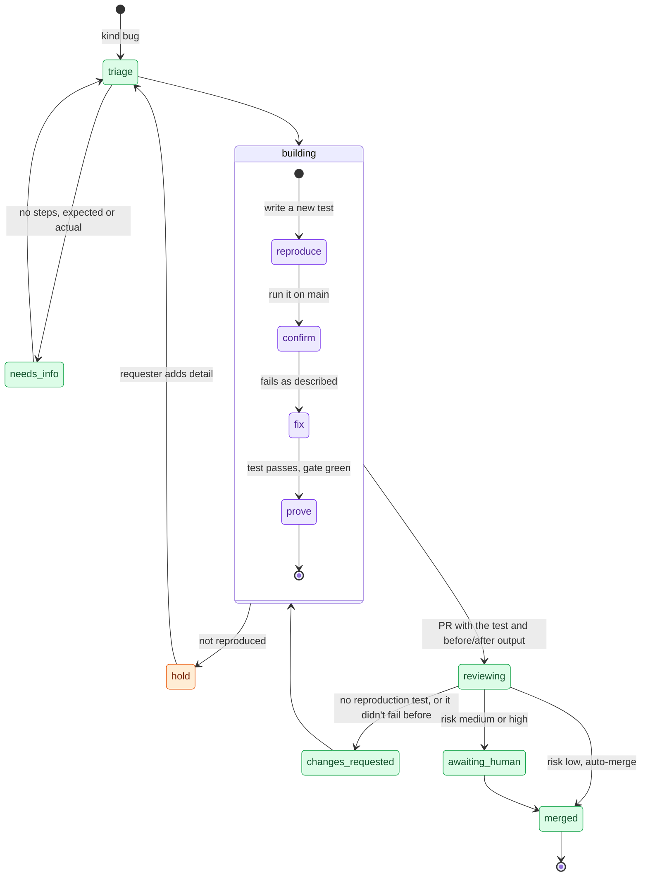
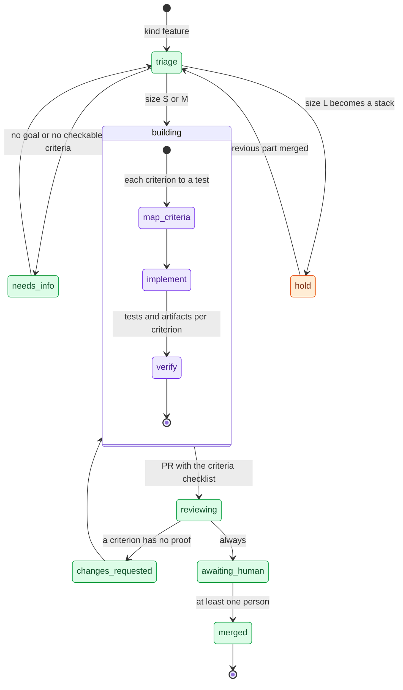
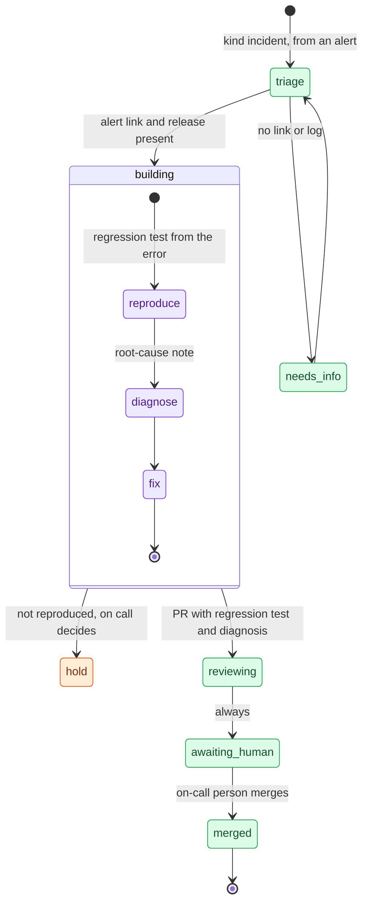
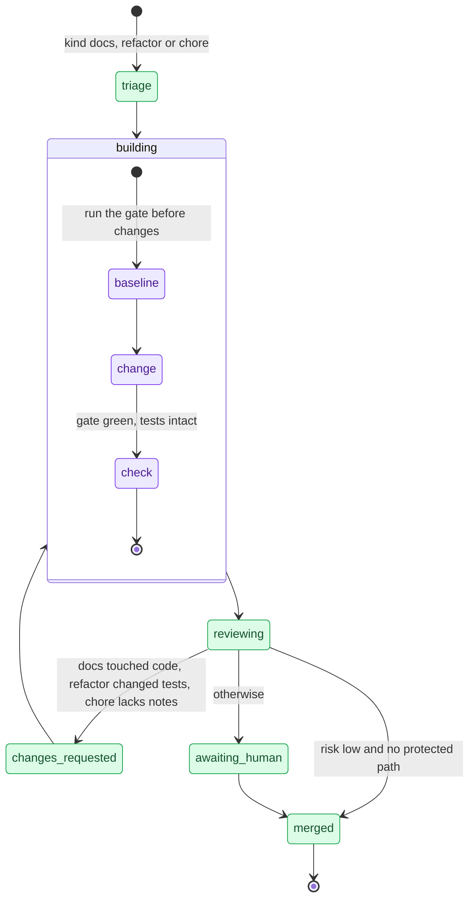

# Request kinds

> **In short:** one pipeline, six kinds. The kind adds no states. It changes what goes in, what
> the builder does first, what proof comes out, and how much autonomy the merge gets.

## The problem

A bug, a feature and an incident need different proof. It's tempting to build a separate
pipeline, prompt set and dashboard for each. That multiplies maintenance and hides the shared
spine.

None of the sources runs a separate pipeline per kind of work. They all use one skeleton: intake,
triage with risk, a spec or a reproduction, an isolated build, a deterministic gate, review and
merge. They vary only the evidence and the degree of autonomy [S1][S3][S7][S8][S9].

## How it works

The [kind](../reference/glossary.md) says what a request is: `bug`, `feature`, `incident`, `docs`,
`refactor` or `chore`. It acts at four points of the same pipeline.

1. **Triage picks exactly one kind.** When unsure between two, it picks the more restrictive one.
   A bug fix that needs new behavior is a `feature`. An item with no kind counts as a `feature`.
2. **Triage checks the kind's template.** If a required field is missing, the job goes to
   `needs_info`.
3. **The builder's first step depends on the kind.** A `bug` or an `incident` starts with a test
   that fails.
4. **The reviewer demands the kind's evidence**, and the merge applies the kind's ceiling.

The **merge ceiling** is the most autonomy a job may get at merge time. The effective ceiling is
the most restrictive of risk, kind and protected paths. See [Risk × kind](../06-merge-policy/risk-times-kind.md).

### What goes in

| Kind | Use it when | The request must contain | Builder's first step |
|---|---|---|---|
| `bug` | Existing behavior is wrong | Steps to reproduce, expected vs actual, where | Write a test that reproduces the failure and see it fail on main |
| `feature` | New behavior, or a change users can see | Goal, who uses it, acceptance criteria you can check | Map each criterion to a test or check |
| `incident` | Production error (alert, error tracker, urgent report) | Alert or log link, release, frequency | Write a regression test that reproduces the error, and a root-cause note |
| `docs` | Documentation, text or copy only | What changes and why | Edit |
| `refactor` | Internal improvement with no behavior change, including new lint rules | What improves and why | Run the existing tests before touching code |
| `chore` | Dependencies, CI, build, configuration | What to update, to which version | Read the release notes |

### What comes out

| Kind | Evidence in the PR | Merge ceiling | Minimum people |
|---|---|---|---|
| `bug` | Test fails on main and passes on the branch; screenshot or video if visual | Auto-merge if `risk:low` | 0 |
| `feature` | Checklist: each criterion → its test or artifact | Never auto-merge | 1 |
| `incident` | Regression test and diagnosis | Never auto-merge | 1 (on call) |
| `docs` | The diff touches documentation paths only | Auto-merge if `risk:low` | 0 |
| `refactor` | Existing tests unchanged (only additions allowed) | Auto-merge if `risk:low` | 0 |
| `chore` | Gate green; release notes in the PR | Auto-merge if `risk:low` | 0 |

Goal-oriented work, such as "bring p99 latency under 200 ms" or "keep Android at parity with
iOS", is not a kind. It is a long-running objective that spawns jobs of these kinds. It needs evals
and measurement first [S1]. See [Self-improvement](../08-self-improvement/README.md).

### Where the kind acts on the state machine

The diagram shows the shared [job state machine](../02-deterministic-spine/job-state-machine.md).
The notes mark the three places where the kind matters.

### `bug`: prove it, then fix it

The builder must see the bug before it fixes it. Inside `building`, the purple steps are the
agent's work.

### `feature`: invest before the code

A feature always needs a person. Most of the work is mapping each criterion to a proof.

User-visible changes should ship behind a flag where the product has flags. They should go
through internal dogfooding before general release [S8][S9].

### `incident`: the page arrives with a PR

An incident optimizes for speed to a candidate fix. The on-call person always merges.

The value is speed, not autonomy. One speaker says even a fix that is right half the time changes
the on-call experience [S8]. No source argues for merging incident fixes without a person. See
[Incidents](../06-merge-policy/incidents.md) for the alert on stuck incident jobs.

### `docs`, `refactor` and `chore`: autonomy earned by static checks

These kinds can merge on their own at `risk:low`, because the gate can check most of what matters.

Small text changes need no person after the checks pass [S7]. A pattern fixed by hand twice
should become a lint rule through a `refactor` job [S2]. See
[Lint rules that teach](../03-guardrails/teaching-lint-rules.md).

## Example

Triage gives Ana's request the kind `bug`. Her message already has the steps, the expected result
and the actual result, so the template is complete.

The builder's first step is a test. It exports a row with "São Paulo" and checks the text that a
spreadsheet app reads back. On main, the test fails with "São Paulo", exactly as Ana described.
The builder fixes the encoding, and the test passes. The PR shows the test output before and
after. The risk is `low` and the kind allows it, so the PR can auto-merge.

> [!IMPORTANT]
> Protected paths force a human merge for **every** kind, not only `docs` (`GR-24`, `MG-09`).

> [!WARNING]
> **Treating the source as the kind.** "It came from the error tracker, so it's an incident" is
> wrong. Source says where a request came from; kind says what it is.

> [!WARNING]
> **Fixing a bug nobody reproduced.** Without a failing test, you can't tell whether the fix fixes
> anything. Stop and put the job on hold instead.

## Checklist

- **IN-19** Triage MUST assign exactly one kind: `bug`, `feature`, `incident`, `docs`, `refactor`
  or `chore`.
- **IN-20** When unsure between two kinds, triage MUST pick the more restrictive one. A bug fix
  that needs new behavior is a `feature`.
- **IN-21** An item with no kind MUST be treated as `feature`.
- **IN-22** Kind MUST NOT add states to the job state machine. It sets parameters on the existing
  stages.
- **IN-23** The effective merge ceiling MUST be the most restrictive of risk, kind and protected
  paths (see [Risk × kind](../06-merge-policy/risk-times-kind.md)).
- **IN-24** A `bug` or `incident` that the builder can't reproduce MUST stop with no PR and go to
  `hold` with a "not reproduced" note. The requester (for an incident, the on-call person) MUST be
  told.

## Sources

[S1] [S2] [S3] [S7] [S8] [S9] [R]

## Up

[01. Work intake](README.md)
