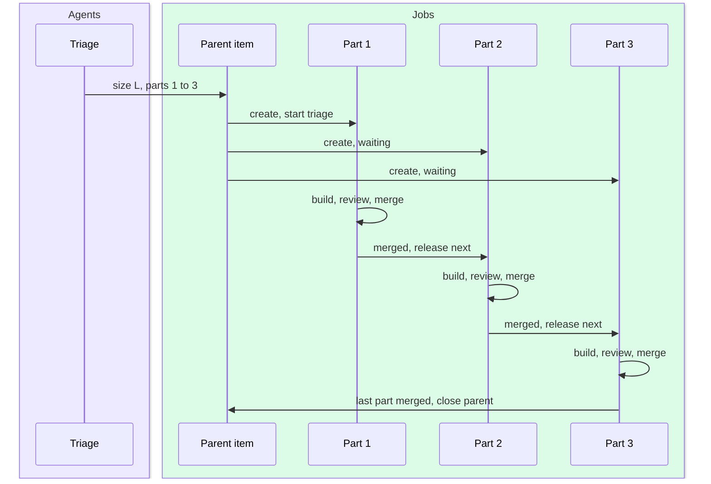

# Sizing and stacks

> **In short:** small jobs are easy to review, retry and throw away. Split a large request into a
> stack of small ones.

## The problem

Long agent runs drift. A job that spans an epic produces a diff nobody can review, and when it
fails, you throw away all of it.

Splitting the work isn't enough on its own. If you open every part at once on stacked branches,
rebases and conflicts eat the savings.

## How it works

A [stack](../reference/glossary.md) is a large request split into ordered parts, each a small job.

1. **Triage sets a size**: `S`, `M` or `L`. A job must fit one bounded run, meaning a fixed budget
   of turns and wall-clock time, and touch one module.
2. **An `L` request never goes to a builder.** Triage splits it into two to five ordered parts.
   Each part is a job with its own risk and kind, linked to a parent item.
3. **Only the first part starts.** The others wait.
4. **Each next part starts only after the previous one merges.** It builds on merged code, not on
   an open branch.
5. **The stack stops when a part fails or goes on hold.** The requester hears which part stopped
   and why.
6. **When the last part merges, the parent closes.**

Running triage again on a parent that is already a stack doesn't create the parts again.

The diagram shows a stack of three parts.

Split by dependency, not by layer: "schema and migration", then "API that uses it", then "UI that
uses the API". Each part must leave the main branch working. Keep the parent item as the place
where the requester follows progress.

## Example

Ana's bug is size `S`, so it needs no stack. Her next request is bigger: "add a date filter to the
CSV export".

Suppose triage sizes it `L`, because it needs a new query parameter and a new control in the UI.
Triage splits it into two parts. Part 1 adds a date range to the export API, and keeps today's
behavior when no range is given. Part 2 adds the date picker to the export screen. Part 2 waits
until part 1 merges, then builds on it.

> [!TIP]
> Turn budgets are a sizing tool, not just a cost cap. If good jobs keep hitting the budget, the
> jobs are too big.

> [!WARNING]
> **"Just one more area."** A builder that decides mid-run to touch another part of the codebase
> breaks the size triage set. Keep the job to the module triage chose.

## Checklist

- **IN-25** A job MUST fit one bounded run (a fixed budget of turns and wall-clock time) and touch
  one module.
- **IN-26** Triage MUST assign a size (`S`, `M`, `L`). Size `L` MUST NOT go to a builder.
- **IN-27** An `L` request MUST be split into 2 to 5 ordered parts, each a job with its own risk
  and kind, linked to a parent item.
- **IN-28** Only the first part MAY start. Each next part MUST start only after the previous one
  merges, so it builds on merged code, not on an open branch.
- **IN-29** The stack MUST stop when any part fails or is put on hold, and the requester MUST be
  told which part stopped and why.
- **IN-30** Running triage again on a parent that is already a stack MUST NOT create the parts
  again.

## Sources

[S3] [S8] [R]

## Up

[01. Work intake](README.md)
