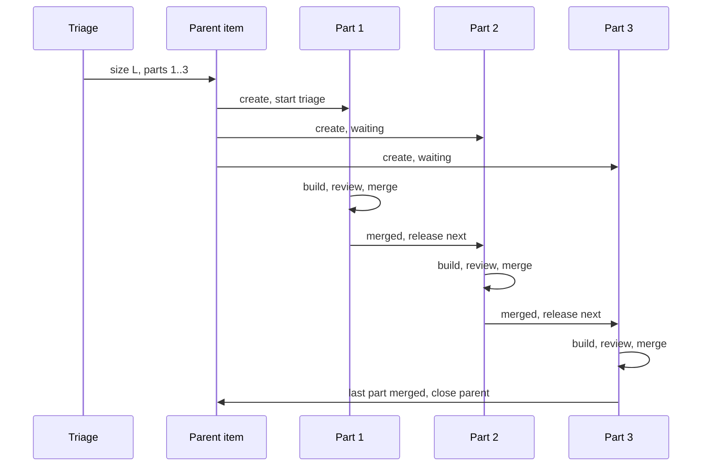

# Sizing and stacks

> Small jobs are reviewable, retryable and cheap to throw away. Large requests become a stack.

## Rules

- **IN-25** A job MUST fit one bounded run (a fixed budget of turns and wall-clock time) and touch
  one module.
- **IN-26** Triage MUST assign a size (`S`, `M`, `L`). Size `L` MUST NOT go to a builder.
- **IN-27** An `L` request MUST be split into 2 to 5 ordered parts, each a job with its own risk
  and kind, linked to a parent item.
- **IN-28** Only the first part MAY start. Each next part MUST start only after the previous one
  merges, so it builds on merged code, not on an open branch.
- **IN-29** The stack MUST stop when any part fails or is put on hold, and the requester MUST be
  told which part stopped and why.
- **IN-30** Re-running triage on a parent that is already a stack MUST NOT create parts again.

## Diagram

## How to apply

- Turn budgets are a sizing tool, not just a cost cap. If good jobs regularly hit the budget, the
  jobs are too big.
- Split by dependency, not by layer: "schema + migration", then "API using it", then "UI using
  the API". Each part must leave the main branch working.
- Keep the parent item as the place where the requester follows progress.

## Anti-patterns

- Opening all parts at once on stacked branches. Rebases and conflicts eat the savings.
- Letting the builder decide mid-run that it needs "just one more" area of the codebase.

## Sources

[S3] [S8] [R]

## Up

[01. Work intake](README.md)
