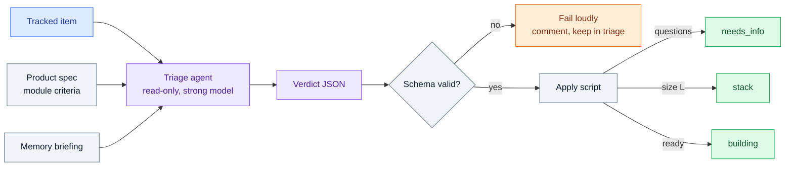

# Triage and risk

> **In short:** triage is a judgment call made by a strong model, written as data and applied by
> code.

## The problem

Someone has to decide how risky a request is before anyone builds it. If the builder decides, it
grades its own work. If triage can edit the repository, it starts "fixing small things while it
is there", and judgment gets mixed with action.

Saving money with the weakest model doesn't work either. You pay for it later in rebuilds [S3].

## How it works

[Triage](../reference/glossary.md) is the read-only step that classifies a request. It can read
the repository, the product spec and memory. It can't push, label or comment.

1. **The triage agent gets three inputs**: the tracked item, the product spec for the module, and
   a memory briefing.
2. **It returns a verdict as JSON** with at least: `risk`, `kind`, `size`, `goal`,
   `acceptance_criteria`, `out_of_scope`, `plan`, `affected_paths` and `questions`.
3. **A script checks the schema.** An invalid verdict fails loudly: the script comments on the
   item and keeps it in `triage`.
4. **The script applies a valid verdict.** It rewrites the item's criteria and plan, and sets the
   risk and kind labels. Then it queues the build or posts the questions.
5. **When the requester answers, triage runs again from scratch.** It doesn't patch the old
   verdict.

Give triage the spec, not just the code. The spec says what "done" means; the code only says what
exists. Ask triage to rewrite the acceptance criteria in a form you can check, because the
reviewer will check against them later.

The diagram shows the inputs, the verdict and where the script sends the job.



### Risk levels

[Risk](../reference/glossary.md) says how bad a wrong change could be. Set it from what the change
could break, not from how hard it looks. An item with no risk label counts as `high`.

| Risk | Typical change | What it means later |
|---|---|---|
| `low` | Docs, tests, internal refactor with no behavior change, small isolated fixes | Can auto-merge if kind and paths allow it |
| `medium` | Changes the behavior of one app without touching sensitive areas | One human approval |
| `high` | Infrastructure, CI, auth, permissions, secrets, production data, the factory itself | Two human approvals |

## Example

Triage reads Ana's issue 412, the spec for the `reports` module, and a briefing from memory. It
returns this verdict:

```json
{
  "risk": "low",
  "kind": "bug",
  "size": "S",
  "goal": "The CSV export keeps accented characters",
  "acceptance_criteria": ["A row with 'São Paulo', exported and opened in a spreadsheet app, shows 'São Paulo'"],
  "out_of_scope": ["Other export formats"],
  "plan": ["Reproduce with a test", "Write the CSV with the right encoding"],
  "affected_paths": ["reports/"],
  "questions": []
}
```

The risk is `low` because it is a small, isolated fix in one module. The schema is valid and there
are no questions, so the script labels the issue and queues the build.

> [!WARNING]
> **Letting the builder set its own risk.** The agent that writes the change shouldn't decide how
> much review it gets. Risk comes from triage.

## Checklist

- **IN-13** The triage agent MUST have read access only: repository, product spec, memory. It
  MUST NOT push, label or comment.
- **IN-14** Triage MUST return a schema-validated object with at least: `risk`, `kind`, `size`,
  `goal`, `acceptance_criteria`, `out_of_scope`, `plan`, `affected_paths`, `questions`.
- **IN-15** A script MUST apply the object: rewrite the item's criteria and plan, set the risk and
  kind labels, and either queue the build or post the questions.
- **IN-16** Triage SHOULD use a strong model. Cheap models are acceptable only for narrow
  classification with its own eval.
- **IN-17** Risk MUST be set from what a wrong change could break, not from how hard the change
  looks.
- **IN-18** An item with no risk label MUST be treated as `high`.

## Sources

[S3] [S8] [S10] [R]

## Up

[01. Work intake](README.md)
