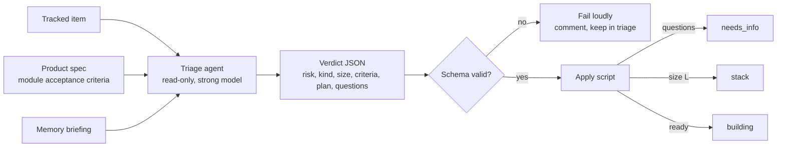

# Triage and risk

> Triage is a judgment call made by a strong model, written as data, applied by code.

## Rules

- **IN-13** The triage agent MUST have read access only: repository, product spec, memory. It
  MUST NOT push, label or comment.
- **IN-14** Triage MUST return a schema-validated object with at least: `risk`, `kind`, `size`,
  `goal`, `acceptance_criteria`, `out_of_scope`, `plan`, `affected_paths`, `questions`.
- **IN-15** A script MUST apply the object: rewrite the item's criteria and plan, set the risk and
  kind labels, and either queue the build or post the questions.
- **IN-16** Triage SHOULD use a strong model. Cheap models are acceptable only for narrow
  classification with its own eval.
- **IN-17** Risk MUST be assigned from what a wrong change could break, not from how hard the
  change looks.
- **IN-18** An item with no risk label MUST be treated as `high`.

## Risk levels

| Risk | Typical change | Consequence downstream |
|---|---|---|
| `low` | Docs, tests, internal refactor with no behavior change, small isolated fixes | Eligible for auto-merge if kind and paths allow |
| `medium` | Changes behavior of one app without touching sensitive areas | One human approval |
| `high` | Infrastructure, CI, auth, permissions, secrets, production data, the factory itself | Two human approvals |

## Diagram

## How to apply

- Give triage the product spec, not just the code. The spec says what "done" means; the code only
  says what exists.
- Make triage rewrite the acceptance criteria in verifiable form ("the export button produces a
  CSV with headers X, Y, Z"), because the reviewer will check against them later.
- Re-run triage from scratch when the requester answers questions. Do not patch the old verdict.

## Anti-patterns

- Letting the builder decide its own risk level.
- A triage prompt that "fixes small things while it is there".
- Using the weakest available model to save cost, then paying for it in rebuilds [S3].

## Sources

[S3] [S8] [S10] [R]

## Up

[01. Work intake](README.md)
