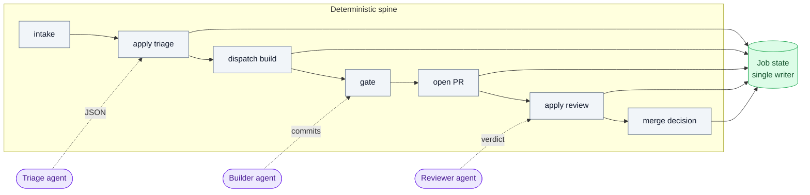

# 02. Deterministic spine

> **In short:** code moves the work, and models think inside the boxes. The spine is the part of
> the factory you can reason about, test and replay.

## The problem

A factory made of agents that call each other is expensive and impossible to debug. Orchestrating
with a model burns tokens on decisions a `case` statement could make [S6].

There is a trust problem too. An agent that edits its own job state can lie about it. It can mark
a job done that isn't done.

## How it works

The [deterministic spine](../reference/glossary.md) is the non-LLM code that moves work between
stages: scripts, workflows and a state machine. The sources that run at volume put this spine
around their agents [S3][S4][S5].

1. **An event triggers one stage.** A label, a comment or a webhook starts the script for that
   stage, and only that stage.
2. **The script starts the agent with hard limits**: a number of turns, a wall-clock time and a
   concurrency cap.
3. **The agent returns its output**: a JSON verdict, commits, or a review verdict.
4. **The script checks and applies the output.** It moves the job through the job CLI, the only
   program that writes job state. The CLI accepts only moves from a declared table.
5. **A failure lands in a visible state** and is posted to the requester's thread.
6. **A person can stop anything.** Every state except the final one can move to `hold`.

A pipeline state written only by a script makes every job auditable and every move testable [S3].
Factories defined as code can be versioned, diffed, rolled back and improved by agents through
pull requests [S4][S5]. That only works if the definition is deterministic. Concurrency limits
prevent runaway spawning and exhausted resources [S3].

The diagram shows the stages in gray and the agents in purple. Agents hand data to a stage; only
stages write the job state.

## Example

Ana's issue 412 moves through the spine without any agent deciding what comes next. The triage
agent returns JSON. The apply script reads it, sets the labels and moves the job to `building`.

The builder then commits to `factory/issue-412`, inside its turn and time limits. It can't mark
the job as reviewed or merged. The gate script checks the commits, a script opens the PR, and the
merge script decides the merge.

> [!WARNING]
> **A manager agent.** An agent that reads the backlog and decides what each worker does next is
> an expensive, untestable `case` statement. Put that logic in code.

> [!WARNING]
> **Retries without a counter.** A loop that retries until it works can run until the budget is
> gone. Count every attempt, and stop at a limit.

## In this section

| Page | Read it to learn |
|---|---|
| [Job state machine](job-state-machine.md) | The nine states, the allowed moves, and why there are so few |
| [Single writer](single-writer.md) | Why one CLI owns the job record |
| [Idempotent dispatch](idempotent-dispatch.md) | How to survive repeated events and duplicate triggers |
| [Failure handling](failure-handling.md) | How failed, held and stuck jobs stay visible, with bounded retries |

## Checklist

- **SP-01** The sequence of stages and the moves between them MUST be implemented in
  deterministic code, not decided by an LLM.
- **SP-02** Each job MUST have an explicit state from a closed set, and only moves from a declared
  table MUST be allowed.
- **SP-03** Job state MUST have exactly one writer: a CLI or service that enforces the table.
  Agents call it; they never write the state store.
- **SP-04** Every stage MUST be idempotent on the identity of the event that triggered it.
- **SP-05** Every failure MUST land the job in a visible state and notify the requester's thread.
  No job may disappear silently.
- **SP-06** Every agent run MUST have hard limits: turns, wall-clock time and concurrency.
- **SP-07** Any state other than the final one MUST be able to move to `hold`, so a person can stop
  anything at any time.

## Sources

[S3] [S4] [S5] [S6] [R]

## Up

[Manifesto](../../README.md)
