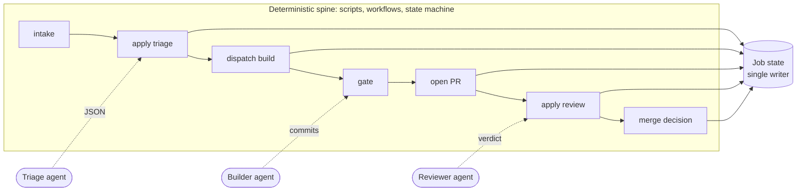

# 02. Deterministic spine

> Code moves the work. Models think inside the boxes. The spine is the part of the factory you
> can reason about, test and replay.

A factory made of agents that call each other is expensive and impossible to debug. Orchestrating
with an LLM burns tokens on decisions a `case` statement could make [S6], and an agent that edits
its own job state can lie about it. The sources that run at volume put a deterministic spine of
scripts, workflows and a state machine around the agents [S3][S4][S5].

## Rules

- **SP-01** The sequence of stages and the transitions between them MUST be implemented in
  deterministic code, not decided by an LLM.
- **SP-02** Each job MUST have an explicit state from a closed set, and only transitions from a
  declared table MUST be allowed.
- **SP-03** Job state MUST have exactly one writer: a CLI or service that enforces the table.
  Agents call it; they never write the state store.
- **SP-04** Every stage MUST be idempotent on the identity of the event that triggered it.
- **SP-05** Every failure MUST land the job in a visible state and notify the requester's thread.
  No job may disappear silently.
- **SP-06** Every agent invocation MUST have hard limits: turns, wall-clock time and concurrency.
- **SP-07** Any state other than the final one MUST be able to move to `hold`, so a person can stop
  anything at any time.

## Diagram

## Why

- A pipeline state written only by a script makes every job auditable and every transition
  testable [S3].
- Factories defined as code can be versioned, diffed, rolled back and improved by agents through
  pull requests [S4][S5]. That only works if the definition is deterministic.
- Concurrency limits prevent runaway spawning and exhausted resources [S3].

## Anti-patterns

- A "manager agent" that reads the backlog and decides what each worker does next.
- Agents writing a status file or a database row directly.
- Retries without a counter.

## Sources

[S3] [S4] [S5] [S6] [R]

## Go deeper

1. [Job state machine](job-state-machine.md): the states, the transitions, and why there are so few.
2. [Single writer](single-writer.md): one CLI owns the job record.
3. [Idempotent dispatch](idempotent-dispatch.md): surviving redelivered events and duplicate triggers.
4. [Failure handling](failure-handling.md): failed, hold, stuck jobs and retry budgets.

## Up

[Manifesto](../../README.md)
