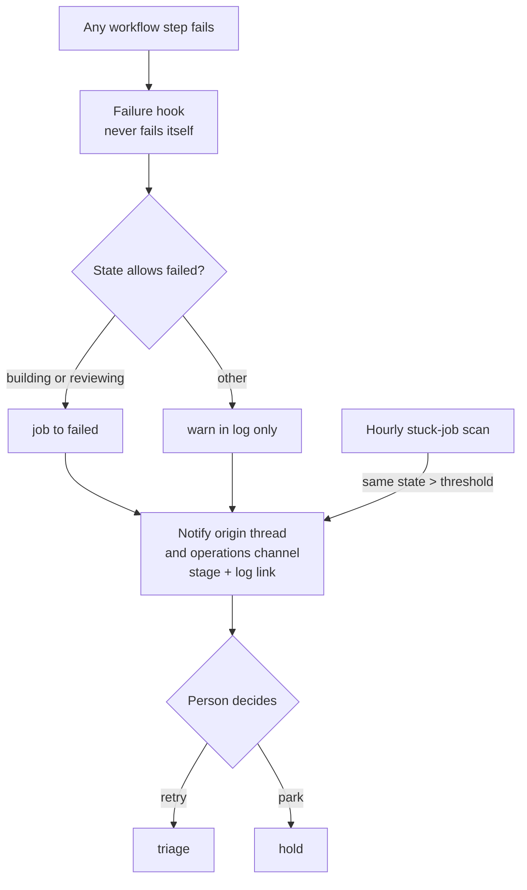

# Failure handling

> A factory at volume fails every day. What matters is that each failure is visible, bounded and
> recoverable by one person action.

## Rules

- **SP-24** Every workflow MUST end with a failure hook that moves the job to `failed` (when the
  current state allows it) and posts to the origin thread and an operations channel, with the
  stage that failed and a link to the log.
- **SP-25** The failure hook itself MUST never fail the workflow: errors in it become warnings.
- **SP-26** Retries MUST be bounded: attempts per job, review rounds per PR, re-triage per
  request. When the bound is reached, the job MUST go to `hold`.
- **SP-27** A scheduled job SHOULD alert on jobs that stayed in the same active state longer than a
  threshold. `needs_info`, `hold` and `merged` are excluded; `failed` is included.
- **SP-28** A person MUST be able to recover any job with one action: move it from `hold` or
  `failed` back to `triage` or `building`.

## Diagram

## Anti-patterns

- Infinite "self-healing" loops where the agent retries until the budget is gone.
- Failures that only exist in CI logs nobody reads.

## Sources

[S1] [S3] [R]

## Up

[02. Deterministic spine](README.md)
