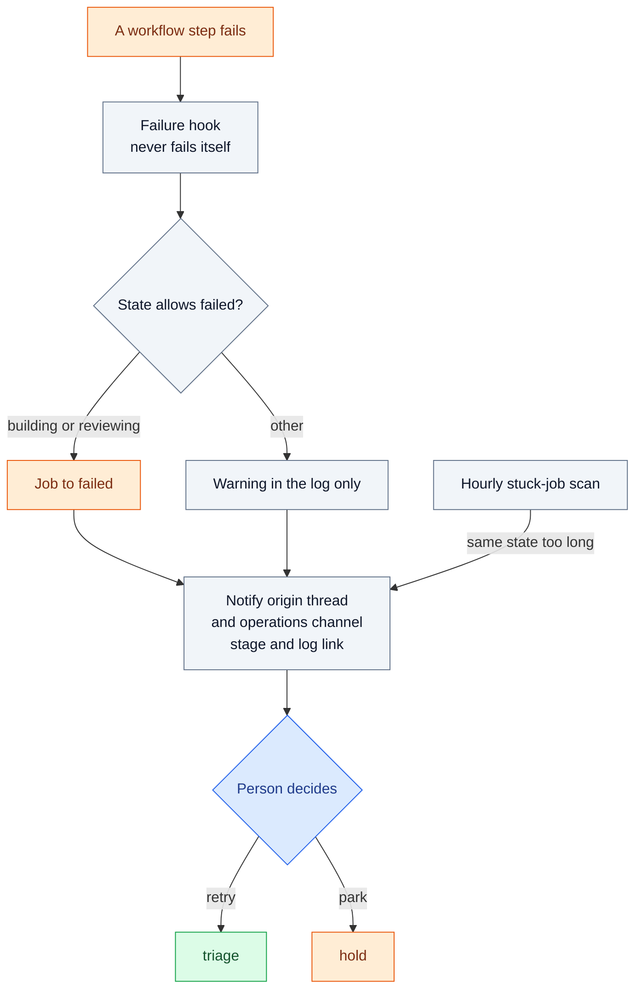

# Failure handling

> **In short:** a factory at volume fails every day. Make each failure visible, bounded, and
> fixable with one action by one person.

## The problem

Most failures are boring: a runner crashes, a token expires, a test is flaky. The damage comes
from how they show up. A failure that lives only in a CI log nobody reads leaves the job stuck,
and the requester waiting.

The other trap is "self-healing". An agent that retries until it works can loop until the budget
is gone.

## How it works

1. **Every workflow ends with a failure hook.** When any step fails, the hook runs.
2. **The hook moves the job to `failed`**, when the current state allows it (`building` or
   `reviewing`). It posts to the origin thread and to an operations channel, with the failed stage
   and a link to the log.
3. **The hook never fails the workflow itself.** Errors inside it become warnings.
4. **Retries have limits**: attempts per job, review rounds per PR, re-triage per request. When a
   job reaches a limit, it goes to `hold`.
5. **A scheduled scan finds stuck jobs.** It alerts on jobs that stayed in the same active state
   longer than a threshold. It skips `needs_info`, `hold` and `merged`, but includes `failed`.
6. **A person recovers a job with one action**: a move from `failed` back to `triage`, or from
   `hold` back to `triage` or `building`.

The diagram shows what happens after a step fails, and how the stuck-job scan joins the same path.

## Example

Ana's builder container crashes halfway through the build. The failure hook moves issue 412 from
`building` to `failed`. It posts in Ana's thread and in the operations channel: the build stage
failed, with a link to the log. A person reads the log and clicks retry, which moves the job back
to `triage`.

Suppose instead that the reviewer keeps rejecting the PR. The first two returns go back to the
builder. The third return puts the job on `hold`, and a person takes a look.

> [!WARNING]
> **Infinite self-healing loops.** An agent that retries until it succeeds spends your budget on
> the same mistake. Count attempts and stop at the limit.

## Checklist

- **SP-24** Every workflow MUST end with a failure hook. The hook moves the job to `failed` (when
  the current state allows it) and posts to the origin thread and an operations channel, with the
  stage that failed and a link to the log.
- **SP-25** The failure hook itself MUST never fail the workflow: errors in it become warnings.
- **SP-26** Retries MUST have limits: attempts per job, review rounds per PR, re-triage per
  request. When a limit is reached, the job MUST go to `hold`.
- **SP-27** A scheduled job SHOULD alert on jobs that stayed in the same active state longer than a
  threshold. `needs_info`, `hold` and `merged` are excluded; `failed` is included.
- **SP-28** A person MUST be able to recover any job with one action: move it from `failed` back
  to `triage`, or from `hold` back to `triage` or `building`.

## Sources

[S1] [S3] [R]

## Up

[02. Deterministic spine](README.md)
