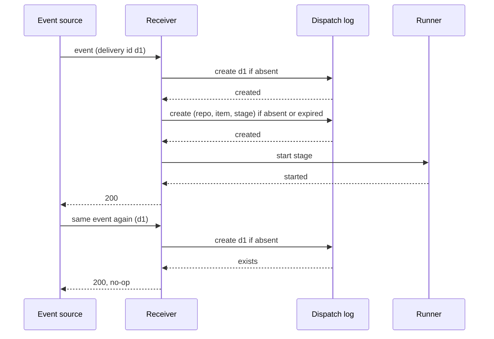

# Idempotent dispatch

> Webhooks arrive twice. Labels get re-applied. A person clicks "retry". The factory must start
> exactly one run each time it should.

## Rules

- **SP-19** Every dispatch MUST record the delivery id of the triggering event before starting
  work, using a create-if-absent write. A second delivery with the same id MUST be a no-op.
- **SP-20** Every dispatch MUST also be keyed on (repository, item, stage). A new run for the same
  key MUST be refused while the previous one could still be running (for example within the
  run's wall-clock limit).
- **SP-21** When dispatch itself fails (the runner could not start), the receiver MUST return an
  error so the sender retries, instead of acknowledging and dropping the event.
- **SP-22** Each trigger (label, command, event) MUST dispatch only its own stage.
- **SP-23** When moving a stage from one execution engine to another, the old path MUST be
  disabled by configuration in the same change, so both never run.

## Diagram

## Sources

[S3] [R]

## Up

[02. Deterministic spine](README.md)
