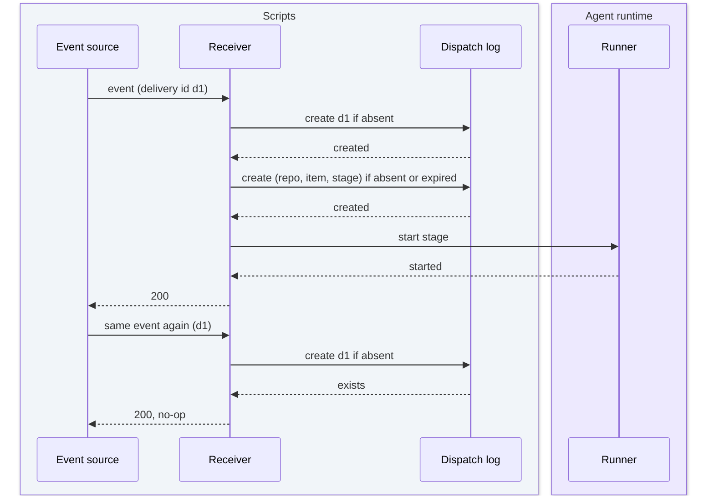

# Idempotent dispatch

> **In short:** the factory must start exactly one run each time it should, even when the same
> trigger arrives twice.

## The problem

Webhooks arrive twice. Labels get applied again. A person clicks "retry" while the first run is
still going. If each of these starts a run, two builders work on the same item at once, and you
pay for both.

The opposite failure is quieter. The receiver says "got it" to the sender, then fails to start the
runner. The sender never retries, and the event is gone.

## How it works

Dispatch is the step that turns an event into a run. Idempotent means a repeated event has no
extra effect.

1. **Record the delivery id first.** Before starting work, the receiver writes the event's
   delivery id with a create-if-absent write. If the id already exists, it stops: a no-op.
2. **Record the job key.** The receiver also writes a key of (repository, item, stage). It refuses
   a new run for the same key while the previous one could still be running, for example within
   the run's wall-clock limit.
3. **Start the runner.** If the runner can't start, the receiver returns an error, so the sender
   retries. It never acknowledges an event and then drops it.
4. **Start only the trigger's own stage.** A label, a command or an event dispatches its own stage
   and nothing else.

The diagram shows one event delivered twice.

## Example

A label on Ana's issue 412 starts the build, and the tracker sends a webhook. The receiver is slow
to answer, so the tracker sends the same delivery again. The second copy has the same delivery id,
so the receiver does nothing.

A few minutes later, someone clicks "retry". This event has a new delivery id. But the key
(repository, 412, build) is still inside the run's wall-clock limit, so the receiver refuses it.
Only one builder ever works on `factory/issue-412`.

> [!WARNING]
> **Two engines for one stage.** When you move a stage to a new execution engine, it's easy to
> leave the old path on. Then both start a run for the same event. Disable the old path by
> configuration in the same change.

## Checklist

- **SP-19** Every dispatch MUST record the delivery id of the triggering event before starting
  work, using a create-if-absent write. A second delivery with the same id MUST do nothing.
- **SP-20** Every dispatch MUST also be keyed on (repository, item, stage). A new run for the same
  key MUST be refused while the previous one could still be running (for example within the
  run's wall-clock limit).
- **SP-21** When dispatch itself fails (the runner couldn't start), the receiver MUST return an
  error so the sender retries, instead of acknowledging and dropping the event.
- **SP-22** Each trigger (label, command, event) MUST dispatch only its own stage.
- **SP-23** When moving a stage from one execution engine to another, the old path MUST be
  disabled by configuration in the same change, so both never run.

## Sources

[S3] [R]

## Up

[02. Deterministic spine](README.md)
