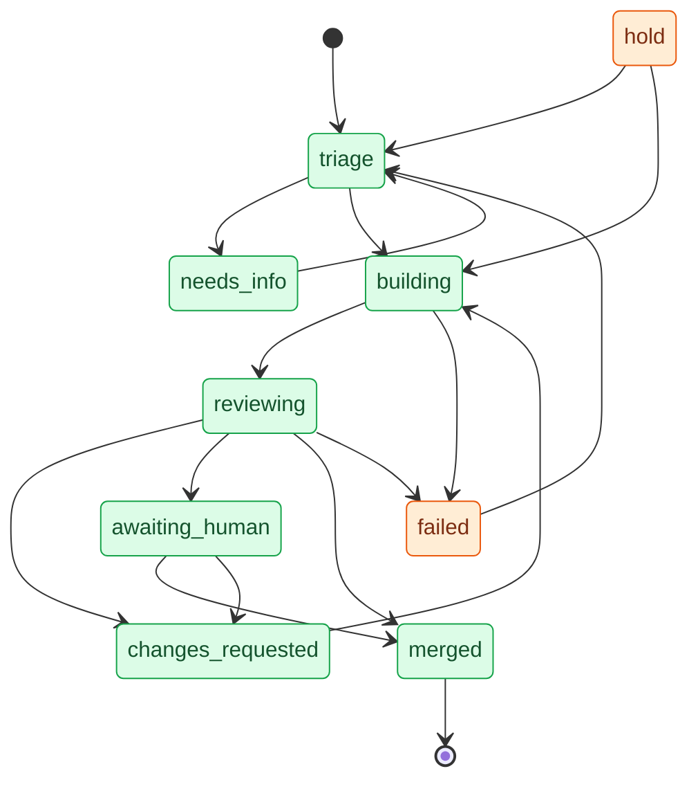

# Job state machine

> **In short:** nine states are enough for every kind of work. When a new need appears, first try
> to express it as a parameter of an existing state.

## The problem

Without explicit states, you can't answer simple questions. Where is this job? How long has it
been there? Who moved it, and why?

The opposite mistake is a new state for every new need: one for incidents, one for stacks, one for
each source. Each new state brings new moves to allow, test and explain. Most needs fit as a label
or a field on a state you already have.

## How it works

A [job](../reference/glossary.md) is the record of one request moving through the factory. Its
state machine has six rules.

1. **A job is in exactly one state** from the closed set below.
2. **Only moves in the table are accepted.** The CLI rejects any other move with an error, and
   leaves the record unchanged.
3. **Every move adds a history entry**: the target state, a UTC timestamp, and a short note saying
   who or what moved it.
4. **Entering `building` counts an [attempt](../reference/glossary.md).** The counter makes loops
   visible, so they can be bounded.
5. **`merged` is final.** Reopened work is a new job.
6. **Any state except `merged` can move to `hold`**, so a person can stop anything.

### States

| State | Meaning |
|---|---|
| `triage` | Request received, being classified |
| `needs_info` | Triage asked questions; waiting for the requester |
| `building` | Builder agent working (each entry counts an attempt) |
| `reviewing` | PR open; reviewer agent and CI checking it |
| `changes_requested` | Reviewer asked for changes; goes back to the builder |
| `awaiting_human` | Waiting for human approval |
| `merged` | Change integrated (final) |
| `failed` | Execution failed |
| `hold` | Stopped on purpose; needs a person |

### Allowed moves

| From | To |
|---|---|
| `triage` | `needs_info`, `building`, `hold` |
| `needs_info` | `triage`, `hold` |
| `building` | `reviewing`, `failed`, `hold` |
| `reviewing` | `changes_requested`, `awaiting_human`, `merged`, `failed`, `hold` |
| `changes_requested` | `building`, `hold` |
| `awaiting_human` | `merged`, `changes_requested`, `hold` |
| `merged` | none |
| `failed` | `triage`, `hold` |
| `hold` | `triage`, `building` |

The diagram shows the same table. Green states are the normal path; orange states stop the line.
The moves into `hold` from every other state are left out, so the diagram stays readable.

### Why some moves are missing

- **There is no `building → needs_info`.** A builder that finds missing information goes to
  `hold` with a note. A person decides whether to ask the requester or close the job. This keeps
  the builder from starting conversations.
- **`failed` goes back to `triage`, not to `building`.** A failure is new information, and the
  plan may need to change.
- **`reviewing → merged` exists only for auto-merge.** Human merges go through `awaiting_human`,
  so you can measure how much work needed people.

## Example

Ana's job ends with this history. Each entry also has a UTC timestamp, left out here.

| # | To | Note |
|---|---|---|
| 1 | `triage` | Created from a chat request |
| 2 | `building` | Triage applied: `bug`, `risk:low`, size `S` (attempt 1) |
| 3 | `reviewing` | PR opened from `factory/issue-412` |
| 4 | `changes_requested` | Reviewer: the scheduled export still loses accents |
| 5 | `building` | Return 1 of 2 (attempt 2) |
| 6 | `reviewing` | PR updated, gate green |
| 7 | `merged` | Auto-merged by the merge policy |

The history tells the story without anyone having to explain it. One return from review shows
in entries 4 and 5. The job went from `reviewing` straight to `merged`, so no person had to
approve it.

> [!TIP]
> Before you add a state, try a label or a field. A new kind, source or policy almost always fits
> as a parameter on an existing state.

## Checklist

- **SP-08** The job MUST be in exactly one of these states: `triage`, `needs_info`, `building`,
  `reviewing`, `changes_requested`, `awaiting_human`, `merged`, `failed`, `hold`.
- **SP-09** Only the moves in the table above MUST be accepted. An invalid move MUST be rejected
  with an error and MUST NOT change the record.
- **SP-10** Every move MUST append to the job's history: target state, UTC timestamp, and a short
  note saying who or what moved it.
- **SP-11** Entering `building` MUST increment the attempt counter.
- **SP-12** `merged` is final. Reopened work is a new job.
- **SP-13** New work types, sources or policies SHOULD be parameters (labels, fields) on existing
  states, not new states.

## Sources

[S3] [R]

## Up

[02. Deterministic spine](README.md)
