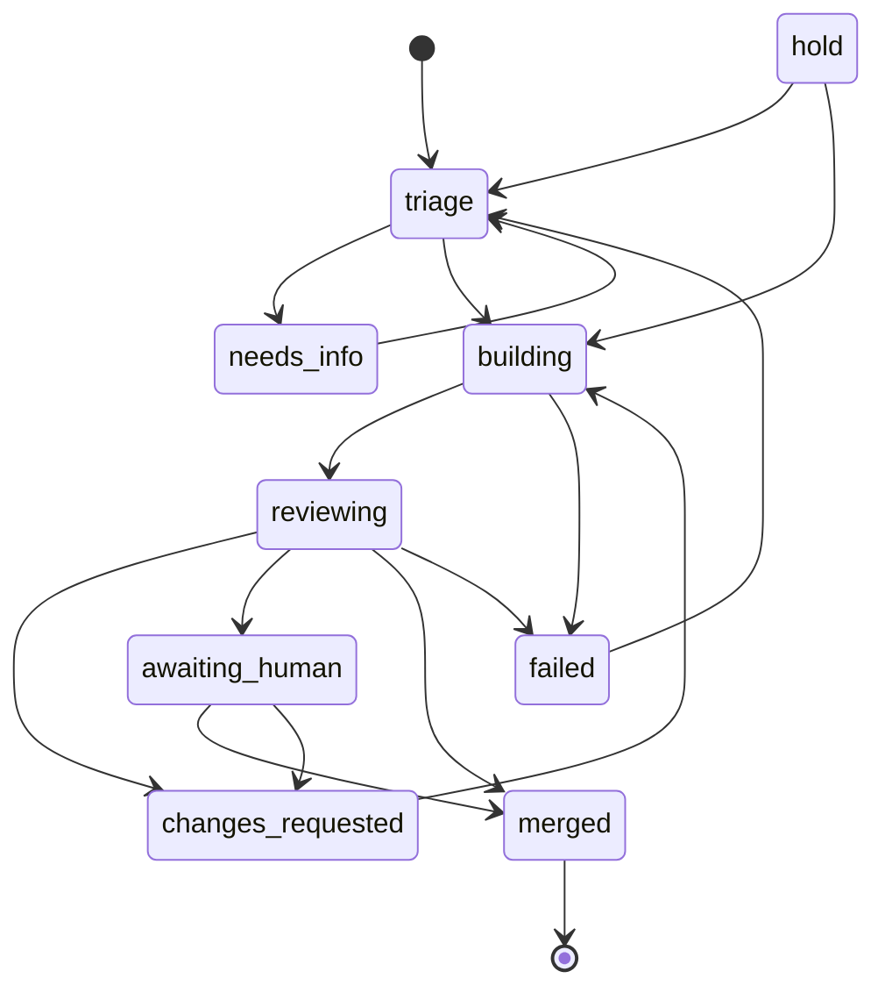

# Job state machine

> Nine states are enough for every kind of work. When a new need appears, first try to express it
> as a parameter of an existing state.

## Rules

- **SP-08** The job MUST be in exactly one of these states: `triage`, `needs_info`, `building`,
  `reviewing`, `changes_requested`, `awaiting_human`, `merged`, `failed`, `hold`.
- **SP-09** Only the transitions in the table below MUST be accepted. An invalid transition MUST
  be rejected with an error and MUST NOT modify the record.
- **SP-10** Every transition MUST append to the job's history: target state, UTC timestamp, a short
  note saying who or what moved it.
- **SP-11** Entering `building` MUST increment the attempt counter.
- **SP-12** `merged` is final. Reopened work is a new job.
- **SP-13** New work types, sources or policies SHOULD be parameters (labels, fields) on existing
  states, not new states.

## States

| State | Meaning |
|---|---|
| `triage` | Request received, being classified |
| `needs_info` | Triage asked questions; waiting for the requester |
| `building` | Builder agent working (each entry counts an attempt) |
| `reviewing` | PR open; reviewer agent and CI evaluating |
| `changes_requested` | Reviewer asked for changes; goes back to the builder |
| `awaiting_human` | Waiting for human approval |
| `merged` | Change integrated (final) |
| `failed` | Execution failed |
| `hold` | Stopped on purpose; needs a person |

## Transitions

| From | To |
|---|---|
| `triage` | `needs_info`, `building`, `hold` |
| `needs_info` | `triage`, `hold` |
| `building` | `reviewing`, `failed`, `hold` |
| `reviewing` | `changes_requested`, `awaiting_human`, `merged`, `failed`, `hold` |
| `changes_requested` | `building`, `hold` |
| `awaiting_human` | `merged`, `changes_requested`, `hold` |
| `merged` | none |
| `failed` | `triage`, `hold` |
| `hold` | `triage`, `building` |

## Diagram

Transitions to `hold` from every non-final state are omitted from the diagram for readability.

## Notable design choices

- There is no `building → needs_info`. A builder that discovers missing information goes to
  `hold` with a note; a person decides whether to ask the requester or close the job. This keeps
  the builder from starting conversations.
- `failed` goes back to `triage`, not to `building`. A failure is new information, and the plan
  may need to change.
- `reviewing → merged` exists only for auto-merge. Human merges go through `awaiting_human`, so
  you can measure how much work needed people.

## Sources

[S3] [R]

## Up

[02. Deterministic spine](README.md)
