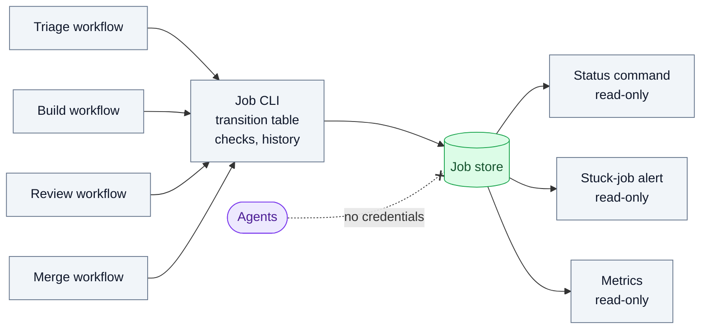

# Single writer

> **In short:** if two programs can write the job record, you have two state machines.

## The problem

The [state machine](job-state-machine.md) only protects you if every write goes through it. When
a workflow writes a database row directly, it skips the table of allowed moves. When an agent
writes a status file, it can mark its own work as done.

Each extra writer carries its own copy of the rules. Over time the copies drift apart, and nobody
knows which one is true.

## How it works

1. **One program writes job records: the job CLI.** Its transition table is the source of truth.
   The documentation mirrors it.
2. **Workflows call the CLI through a wrapper.** The wrapper turns network or credential errors
   into warnings, so an outage of the job store never fails a build.
3. **Agents have no write credentials for the store.** They may call the commands that the spine
   exposes.
4. **Read-only tools read the store directly**: the status command, dashboards and the stuck-job
   alert. They never write it.
5. **The CLI is tested with an in-memory store.** The tests cover every valid and every invalid
   move.

The diagram shows four workflows writing through the CLI, and three tools reading.

These are the commands worth having.

| Command | What it does |
|---|---|
| `create --issue N [--parent P] --risk R` | Creates the record when triage starts |
| `transition --issue N --to STATE --note TEXT` | Changes state; the only way to do it |
| `record --issue N --stage S --cost-usd X --duration-s Y` | Adds up cost and time per stage |
| `set-pr --issue N --pr M` | Links the pull request |
| `show --issue N` | Prints the record |

## Example

The builder for Ana's bug pushes its commits and the build workflow opens the PR. The builder
can't move the job itself. The build workflow runs
`transition --issue 412 --to reviewing --note "PR opened"`.

The CLI checks the table: `building → reviewing` is allowed, so it writes the new state and a
history entry. If the job store were down at that moment, the wrapper would log a warning, and the
build would still succeed.

> [!WARNING]
> **Agents writing state.** An agent that writes a status file or a database row directly
> bypasses every rule in the table. Give agents commands to call, never credentials for the store.

## Checklist

- **SP-14** Exactly one program (the job CLI) MUST write job records. Its transition table is the
  source of truth; documentation mirrors it.
- **SP-15** Agents MUST NOT have write credentials for the job store. They MAY call commands that
  the spine exposes.
- **SP-16** Workflow steps MUST call the CLI through a wrapper that turns network or credential
  errors into warnings, so an outage of the job store never fails a build.
- **SP-17** Read-only tools (status commands, dashboards, stuck-job alerts) MAY read the store
  directly and MUST NOT write it.
- **SP-18** The CLI MUST be testable with an in-memory store, and its tests MUST cover every valid
  and invalid move.

## Sources

[S3] [R]

## Up

[02. Deterministic spine](README.md)
