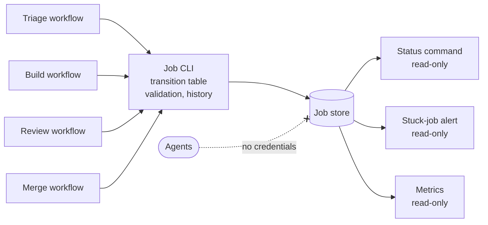

# Single writer

> If two programs can write the job record, you have two state machines.

## Rules

- **SP-14** Exactly one program (the job CLI) MUST write job records. Its transition table is the
  source of truth; documentation mirrors it.
- **SP-15** Agents MUST NOT have write credentials for the job store. They MAY call commands that
  the spine exposes.
- **SP-16** Workflow steps MUST call the CLI through a wrapper that turns network or credential
  errors into warnings, so a registry outage never fails a build.
- **SP-17** Read-only consumers (status commands, dashboards, stuck-job alerts) MAY read the store
  directly and MUST NOT write it.
- **SP-18** The CLI MUST be testable with an in-memory store, and its tests MUST cover every valid
  and invalid transition.

## Diagram

## Commands worth having

| Command | Purpose |
|---|---|
| `create --issue N [--parent P] --risk R` | Create the record when triage starts |
| `transition --issue N --to STATE --note TEXT` | The only way to change state |
| `record --issue N --stage S --cost-usd X --duration-s Y` | Accumulate cost and time per stage |
| `set-pr --issue N --pr M` | Link the pull request |
| `show --issue N` | Print the record |

## Sources

[S3] [R]

## Up

[02. Deterministic spine](README.md)
