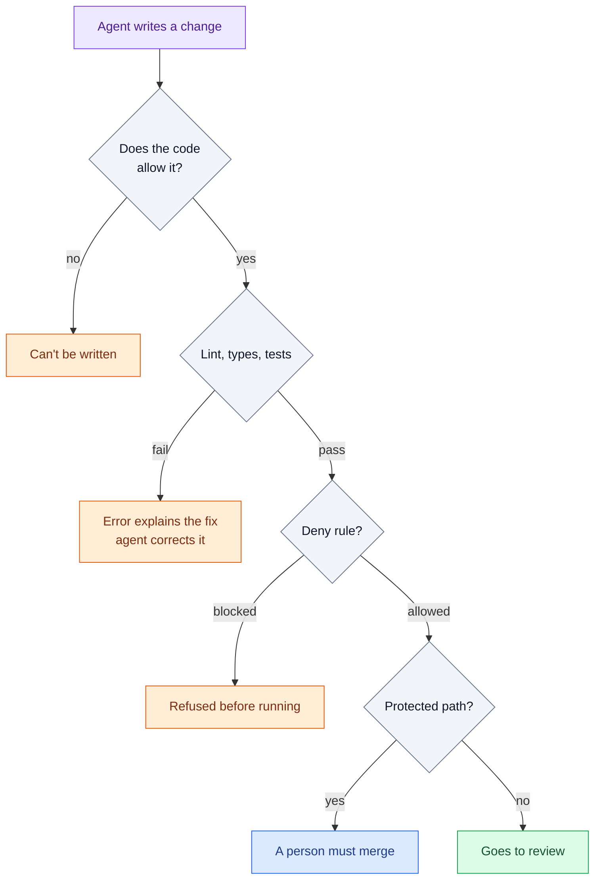

# 03. Guardrails

> **In short:** don't ask agents to behave. Make the wrong thing hard to write, and make the
> irreversible thing impossible to do.

## The problem

When an agent makes a mistake, the natural reaction is to add a line to its instructions:
"Never use X." After a few months the instructions file is long, the agent ignores half of it,
and the same mistakes come back.

Agents copy what they see. If the codebase contains a hack, the next agent will copy the hack.
If you automate a loop that produces messy code, you get more messy code, faster [S2].

## How it works

Guardrails are the checks that stop a bad change. They work best close to the code, where they
are cheap and automatic. You add them in this order of preference:

1. **Shape the code** so the mistake can't be written: a narrow API, a module boundary, a type.
2. **Add a static check**: a lint rule, a type check or a test, with an error message that
   explains the fix.
3. **Check at runtime** what static checks can't reach: UI behavior, concurrency, money.
4. **Write a short instruction** only when none of the above is possible.
5. **Ask a person** only for judgment calls.

Two more guardrails sit outside the code. **Deny rules** block actions that can't be undone, like
reading secrets or force-pushing. **Protected paths** make sure only people can merge changes to
the factory itself.

The diagram shows the checks a change passes through, from cheapest to most expensive.

## Example

Ana's bug (the CSV export loses accents) gets fixed. In review, someone notices that the agent
wrote the file with the wrong encoding in a second place too. It is the third time this year.

Instead of adding "always write CSV as UTF-8" to the instructions, the team adds a lint rule:
CSV files can only be written through one helper, `write_csv()`, which sets the encoding. The
rule's message says exactly that. The mistake can't come back.

> [!WARNING]
> **Growing the instructions file.** Each new "NEVER do X" line makes the file longer and the
> agent's behavior worse. Current models do better with short, factual instructions [S7].

## In this section

| Page | Read it to learn |
|---|---|
| [The inverted pyramid](inverted-pyramid.md) | Where to invest first, and why prose comes last |
| [Lint rules that teach](teaching-lint-rules.md) | How to turn a repeated correction into a check |
| [Minimal agent instructions](minimal-agent-instructions.md) | What belongs in `AGENTS.md`, and what doesn't |
| [Deny rules and protected paths](deny-rules-and-protected-paths.md) | How to block what can't be undone |
| [Least-privilege agents](least-privilege-agents.md) | Why each agent gets only the tools it needs |

## Checklist

- **GR-01** Guardrail effort MUST follow the inverted pyramid: code structure first, then static
  checks, then runtime checks, then short prose, then human review.
- **GR-02** A correction made more than once MUST become an automated check whose error message
  explains the fix.
- **GR-03** Agent instruction files MUST contain only what an agent can't discover from the code.
- **GR-04** Actions that can't be undone MUST be blocked by deny rules in the harness, not
  discouraged in the prompt.
- **GR-05** Changes to protected paths (CI, factory definition, infrastructure, auth) MUST always
  need a human merge.
- **GR-06** Each agent MUST get only the tools and credentials its stage needs.

## Sources

[S2] [S7] [S9] [S10] [R]

## Up

[Manifesto](../../README.md)
