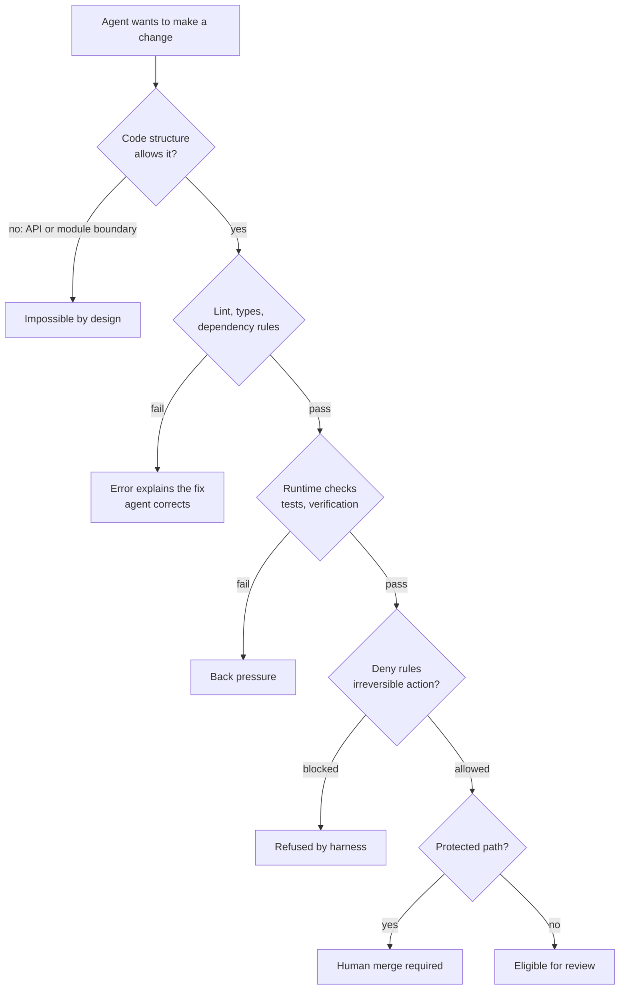

# 03. Guardrails

> Every correction you make to an agent should become a deterministic check in the code, not
> another line in the instructions file.

If the inner loop produces slop, automating it only produces more slop [S2]. The cheapest place
to stop a bad change is before it is written: in the shape of the code, in the linter, in the type
system. Prose instructions come last and stay short.

## Rules

- **GR-01** Investment in guardrails MUST follow the inverted pyramid: code structure first, then
  static analysis, then runtime and formal checks, then a small amount of prose, then human review.
- **GR-02** A correction made to agent output more than once MUST become an automated check
  (lint rule, type, test, dependency rule) whose error message explains the fix.
- **GR-03** Agent instruction files MUST contain only what an agent cannot discover from the code.
- **GR-04** Actions that cannot be undone MUST be blocked by deny rules enforced by the harness,
  not discouraged by the prompt.
- **GR-05** Changes to protected paths (CI, the factory definition, infrastructure, auth) MUST
  always need a human merge.
- **GR-06** Each agent MUST get only the tools and credentials its stage needs.

## Diagram

## Why

- The codebase is the biggest input an agent reads. Anti-patterns and legacy code get copied by
  the next agent [S2].
- Overloaded instruction files with emphatic warnings make current models perform worse [S7].
- Permissions decide whether a command runs; they do not limit what it reaches once running [S7].

## Sources

[S2] [S7] [S9] [S10] [R]

## Go deeper

1. [The inverted pyramid](inverted-pyramid.md): where to invest, from cheapest to most expensive.
2. [Lint rules that teach](teaching-lint-rules.md): turning corrections into checks.
3. [Minimal agent instructions](minimal-agent-instructions.md): what belongs in AGENTS.md.
4. [Deny rules and protected paths](deny-rules-and-protected-paths.md): blocking the irreversible.
5. [Least-privilege agents](least-privilege-agents.md): small agents with small toolsets.

## Up

[Manifesto](../../README.md)
