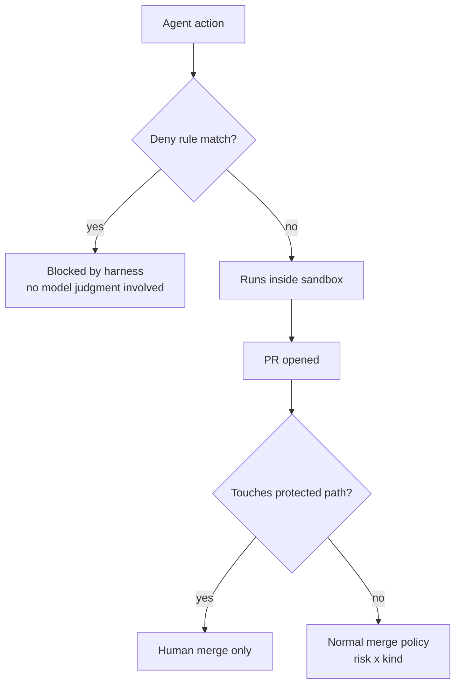

# Deny rules and protected paths

> Ask one question of every action: if the agent gets this wrong once, can it be undone?

Wrong code can be reverted. A leaked secret, a deleted branch, a production deploy or a rewritten
history cannot [S7].

## Rules

- **GR-22** Irreversible actions MUST be denied by the harness before any classifier or model
  judgment runs. Minimum list: reading secret files (`.env*`, keys, state files), force push,
  rewriting the main branch, deleting branches or data, deploying or applying infrastructure,
  merging one's own PR.
- **GR-23** Deny rules MUST be versioned in the repository and reviewed like code.
- **GR-24** The merge policy MUST define protected paths, and any PR touching them MUST need a
  human merge regardless of risk or kind.
- **GR-25** Protected paths MUST include at least: CI and workflow definitions, the factory's own
  definition (prompts, gate, policy), agent instruction files, infrastructure, auth and permission
  code.
- **GR-26** The factory's credentials SHOULD NOT allow changing CI definitions at all. When a job
  needs such a change, the builder MUST leave the patch for a person to apply.

## Diagram

## Why the factory cannot edit its own rules

If an agent can merge a change to the gate, the prompts or the merge policy, every other guardrail
is advisory. Self-improvement still happens (see [Factory-as-code](../08-self-improvement/factory-as-code.md)),
but through PRs that a person merges.

## Sources

[S7] [S9] [R]

## Up

[03. Guardrails](README.md)
