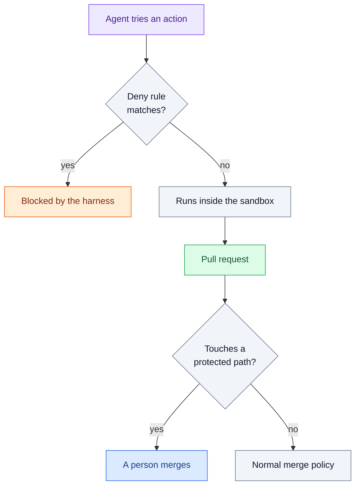

# Deny rules and protected paths

> **In short:** ask one question about every action: if the agent gets it wrong once, can you
> undo it? If not, block it.

## The problem

Wrong code is cheap. You revert the commit. Some mistakes can't be reverted: a leaked secret, a
deleted branch, a rewritten history, a production deploy [S7].

There is a second, quieter risk. If an agent can merge a change to the gate, the prompts or the
merge policy, it can switch off every other guardrail. Nothing else on this page matters if the
factory can rewrite its own rules.

## How it works

Two mechanisms work together.

1. **Deny rules** live in the agent's harness, versioned in the repository. They block an action
   before it runs, before any model decides anything. The minimum list:
   - reading secret files (`.env*`, keys, infrastructure state files);
   - force push, rewriting the main branch, deleting branches or data;
   - deploying or applying infrastructure;
   - merging its own pull request.
2. **Protected paths** live in the merge policy. Any pull request that touches them needs a
   person to merge, whatever its risk. The minimum list: CI definitions, the factory definition
   (prompts, gate, policy), agent instruction files, infrastructure, auth code.

The diagram shows where each one acts.

## Example

Ana's bug fix needs a new environment variable in the CI workflow. In our setup, the factory's
token can't change CI files at all. So the builder does the rest of the work, and leaves the CI
change as a patch in a comment. A person applies it. The friction is on purpose.

> [!IMPORTANT]
> The factory still improves itself. Agents may propose changes to protected paths through pull
> requests. People merge them. See [factory-as-code](../08-self-improvement/factory-as-code.md).

## Checklist

- **GR-22** Irreversible actions MUST be denied by the harness before any model judgment runs. At
  least: reading secret files, force push, rewriting main, deleting branches or data, deploying or
  applying infrastructure, merging one's own PR.
- **GR-23** Deny rules MUST be versioned in the repository and reviewed like code.
- **GR-24** The merge policy MUST define protected paths, and any PR touching them MUST need a
  human merge, whatever its risk or kind.
- **GR-25** Protected paths MUST include at least CI definitions, the factory definition, agent
  instruction files, infrastructure, and auth and permission code.
- **GR-26** The factory's credentials SHOULD NOT allow changing CI definitions. When a job needs
  such a change, the builder MUST leave the patch for a person to apply.

## Sources

[S7] [S9] [R]

## Up

[03. Guardrails](README.md)
