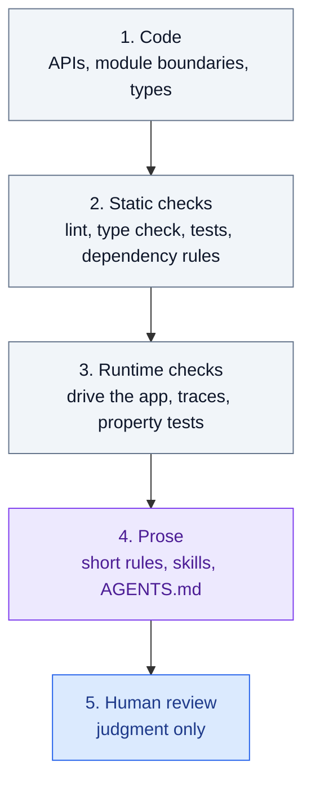

# The inverted pyramid

> **In short:** put your effort where a mistake is cheapest to stop. That is the code itself,
> not the instructions and not the reviewer.

## The problem

There are five places to catch an agent's mistake. They differ a lot in cost. A type error costs
nothing: the compiler finds it in seconds. The same mistake found by a person in review costs
minutes of their attention, every single time.

Teams new to agents usually invest the other way around. They write long instructions and review
everything by hand. That doesn't scale, and the mistakes keep coming [S2].

## How it works

Read the pyramid from top to bottom. The top layer gets the most effort. Each layer catches what
the one above missed, and costs more per mistake.

1. **Code.** Make the mistake impossible to write. A function that only accepts a `Money` type
   can't receive a float.
2. **Static checks.** Catch the mistake before anything runs. A lint rule that bans an import
   between two layers is an example.
3. **Runtime checks.** Run the software and look at what happens. Agents make expensive
   techniques affordable, such as property-based UI tests or formal models for critical flows [S2].
4. **Prose.** Write a rule only when the layers above can't express it.
5. **Human review.** Keep people for what only people can judge: product fit, risk, taste.

## Example

One team found that agents misused a common UI hook and leaked logic between two runtime layers
of a desktop app. They banned the hook in product code with a lint rule, and banned imports
between the layers with a dependency analyzer [S2]. The same team banned almost all code
comments, because agents used comments to justify hacks instead of fixing the cause [S2].

> [!TIP]
> When you catch yourself writing "never do X" in a prompt, stop and ask: can a check say this
> instead?

## Checklist

- **GR-07** The first response to a recurring agent mistake MUST be to ask whether the code can
  make it impossible (a narrower API, a module boundary, a type).
- **GR-08** If it can't, the next response MUST be a static check (lint, types, dependency rules).
- **GR-09** Runtime and formal checks SHOULD cover flows that static checks can't reach, such as
  UI behavior, concurrency and money.
- **GR-10** A prose rule is acceptable only when the layers above can't express it, and SHOULD be
  revisited when tooling improves.
- **GR-11** Human review MUST be kept for judgment: product fit, risk acceptance and taste.

## Sources

[S2] [S7] [S9]

## Up

[03. Guardrails](README.md)
