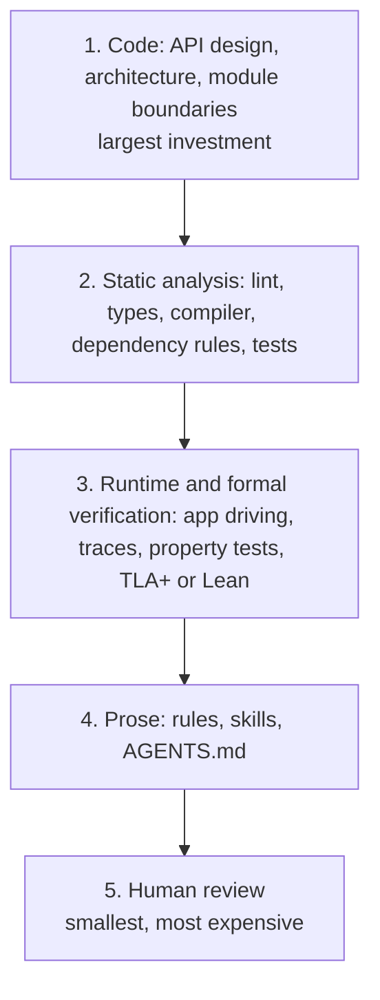

# The inverted pyramid

> Put the most effort where a mistake is cheapest to prevent.

## Rules

- **GR-07** The first response to a recurring agent mistake MUST be to ask "can the code make this
  impossible?" (a narrower API, a module boundary, a type).
- **GR-08** If not, the next response MUST be a static check (lint, types, dependency analyzer).
- **GR-09** Runtime and formal verification SHOULD cover flows where static checks cannot reach:
  UI behavior, concurrency, money.
- **GR-10** A prose rule (instructions file, skill) is acceptable only when the above are not
  feasible, and it SHOULD be revisited when tooling improves.
- **GR-11** Human review MUST be reserved for judgment: product fit, risk acceptance, taste.

## Diagram

Read top to bottom: each layer catches what the layer above could not, and costs more per bug.

## Examples from the sources

- A team banned `useEffect` in product code and banned imports between two runtime layers of a
  desktop app, enforced by lint and a dependency analyzer [S2].
- The same team banned almost all code comments, because agents used them to justify hacks
  instead of fixing the cause [S2].
- Agents make previously expensive techniques viable: property-based UI testing, TLA+ and Lean for
  critical flows [S2].

## Sources

[S2] [S7] [S9]

## Up

[03. Guardrails](README.md)
