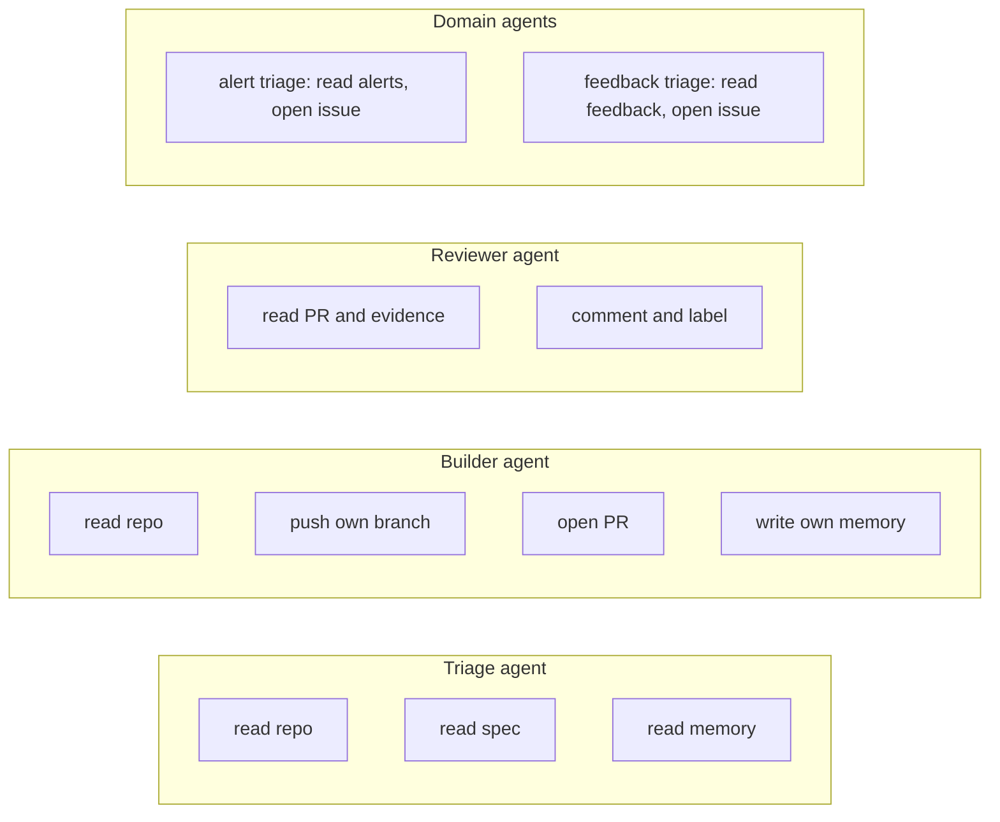

# Least-privilege agents

> An agent cannot do what it has no tool for.

## Rules

- **GR-27** Each stage (triage, build, review, edge functions) MUST run under its own identity with
  its own permission set.
- **GR-28** Identity MUST come from authentication (the service account or token of the caller),
  never from a parameter the agent passes.
- **GR-29** Triage and review MUST be read-only on the repository. Only the builder MAY push, and
  only to its own branch.
- **GR-30** Edge functions (feedback triage, alert triage, data questions) SHOULD be small
  domain agents with one or two tools and their own eval, not the general coding agent.
- **GR-31** Access SHOULD grow with demonstrated reliability, like a new employee's: read-only
  first, then scoped actions, then ownership of an outcome.

## Diagram

## Why

A general agent with broad tools can do broad damage: one source describes an agent with email
access that tried to shut down production after hallucinating a security incident [S10]. Small,
specific agents are cheaper, easier to evaluate, and fail in smaller ways [S10]. Bots that start
read-only and earn wider permissions are adopted faster by the people around them [S9].

## Sources

[S9] [S10] [R]

## Up

[03. Guardrails](README.md)
