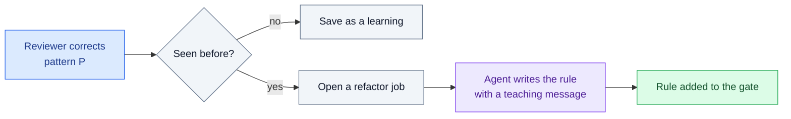

# Lint rules that teach

> **In short:** a good error message is a prompt that arrives exactly when it's needed, and only
> then.

## The problem

Reviewers often fix the same pattern again and again. Each fix helps once. The next agent, in a
fresh session, makes the same mistake.

A plain lint error doesn't help much either. If the message only says "restricted", the agent
tends to silence the rule instead of fixing the cause.

## How it works

1. A reviewer, person or agent, corrects a pattern.
2. If it's the first time, the correction is saved as a learning in the factory's memory.
3. If it's the second time, someone opens a `refactor` job to encode the pattern as a check.
4. The check's error message says **what to do instead and why**, in one or two sentences.
5. The check joins the [gate](../05-verification/single-gate.md), so it applies to everyone.

## Example

After Ana's CSV bug, the team writes a rule that bans opening files in write mode inside the
`reports` module. Compare two messages for the same rule:

| Weak message | Teaching message |
|---|---|
| `no-restricted-call: open() is restricted` | `Write CSV files with reports.io.write_csv(). It sets UTF-8 with BOM, so spreadsheet apps keep accents. Calling open() directly caused bug "CSV export loses accents".` |

The second message tells the agent the fix, the reason and the history. The agent rarely gets it
wrong twice.

> [!WARNING]
> **Allowing suppression comments.** If `# noqa` is free, agents will use it. Ban suppression for
> custom rules, or require a linked reason.

## Checklist

- **GR-12** When a reviewer corrects the same pattern twice, a `refactor` job MUST be opened to
  encode it as a check.
- **GR-13** A custom rule's error message MUST say what to do instead and why, in one or two
  sentences.
- **GR-14** Suppression comments for custom rules SHOULD be banned or require a linked reason.
- **GR-15** New rules MUST run in the single gate, so they apply to builders, CI and people alike.
- **GR-16** The number of checks created from corrections SHOULD be tracked as a health metric.

## Sources

[S2] [S8] [R]

## Up

[03. Guardrails](README.md)
