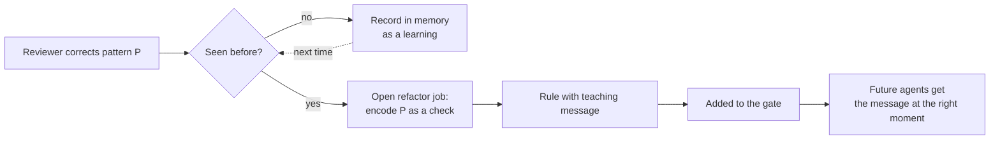

# Lint rules that teach

> An error message is a prompt that arrives exactly when it is needed, and only then.

## Rules

- **GR-12** When a reviewer (human or agent) corrects the same pattern twice, a `refactor` job
  MUST be opened to encode it as a check.
- **GR-13** The error message of a custom rule MUST say what to do instead and why, in one or two
  sentences, so the agent fixes the cause rather than silencing the rule.
- **GR-14** Suppression comments for custom rules SHOULD be disallowed or require a linked reason.
- **GR-15** New rules MUST run in the single gate, so they apply to builders, CI and humans alike.
- **GR-16** The count of checks created from corrections SHOULD be tracked as a metric of how well
  the team "tends the garden".

## Diagram

## Example message

Weak: `no-restricted-imports: 'electron' is restricted`.

Teaching: `Renderer code must not import from main. Send an IPC message through the bridge in
src/bridge instead; direct imports break sandboxing and duplicate state.`

## Sources

[S2] [S8] [R]

## Up

[03. Guardrails](README.md)
