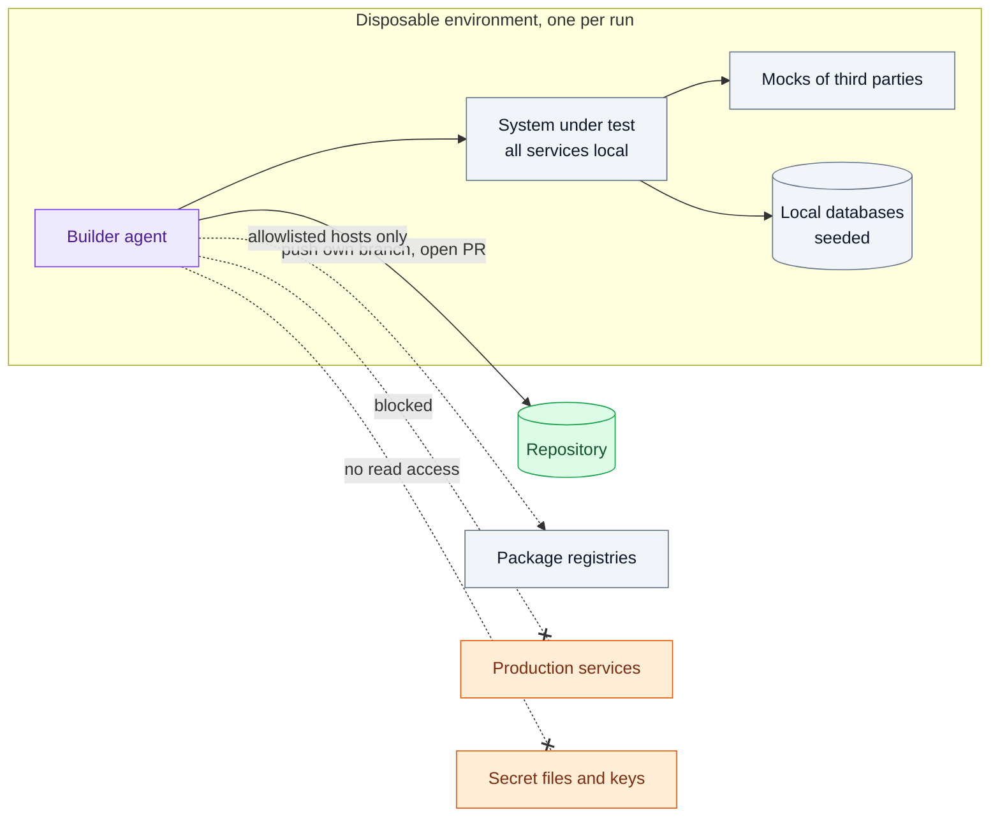

# 04. Sandboxes

> **In short:** each run gets a throwaway machine with the whole system inside it and nothing
> real within reach. The machine is disposable. What leaves it is not.

## The problem

Agents on a laptop work at human speed. They can see the developer's keys. Across a team, nobody
can govern what they do [S4][S7].

Running tests isn't harmless either. `npm test` can run a compromised dependency. Tool
permissions in the agent don't limit that code. Only an operating-system sandbox does [S7].

## How it works

A sandbox is an isolated environment created for one run and destroyed after it. In the cloud,
every run starts clean, can run in parallel and has only the access you give it.

1. **Create a fresh environment for each run.** Nothing is left over from an earlier run.
2. **Start the whole system inside it**, with mocks (local stand-ins) for every third-party and
   production service.
3. **Keep secrets out of the model's reach.** In the cloud there is no `.env`, no SSH key and no
   personal token for the model to find. Secrets can be injected at the network layer [S1][S7].
4. **Allow only listed hosts** on the network, such as package registries.
5. **Enforce the limits in the operating system**: files, folders, hosts and child processes.
6. **Check what leaves.** Commits, pushes, messages and comments still pass the
   [deny rules](../03-guardrails/deny-rules-and-protected-paths.md) and the merge policy.

One team moved every service into containers with mocks, with one VM per agent. That let agents
test anything without risk [S1].

The diagram shows what the [builder](../reference/glossary.md) can and can't reach from inside
its sandbox.

## Example

Ana's bug (the CSV export loses accents) becomes job 412. The builder's run starts in a new
environment made from the latest image. Inside it, the `reports` service starts with a seeded
database and mocks for the outside services it calls.

The builder exports a CSV with "São Paulo" in it and checks the bytes. It can't reach the
production database, and there is no token on disk for it to read. When it's done, it pushes
`factory/issue-412` and the environment is destroyed.

> [!WARNING]
> **Running the factory on a laptop.** It feels faster to start. But the agent sees your keys,
> runs at your speed, and nobody else can see or limit what it does [S4][S7].

## In this section

| Page | Read it to learn |
|---|---|
| [Disposable environments](disposable-environments.md) | How to build run environments from an image, and throw them away |
| [Local with mocks](local-with-mocks.md) | How to run the full system without real services |
| [Secrets and network](secrets-and-network.md) | What the model can and can't reach |
| [Parallel work isolation](parallel-work-isolation.md) | How several agents share one repository safely |

## Checklist

- **SB-01** Builder runs MUST execute in an isolated, disposable environment created for that run
  and destroyed after it.
- **SB-02** The environment MUST be able to run the whole system under test locally, with mocks
  for every third-party and production service.
- **SB-03** No agent MAY touch production services to test its work.
- **SB-04** Secrets MUST NOT be readable by the model. Network egress MUST be restricted to an
  allowlist by default.
- **SB-05** Sandbox limits MUST be enforced by the operating system (files, folders, hosts, child
  processes), not only by tool permissions.
- **SB-06** What leaves the sandbox (commits, pushes, messages, comments) MUST still pass the deny
  rules and the merge policy.

## Sources

[S1] [S4] [S5] [S6] [S7]

## Up

[Manifesto](../../README.md)
