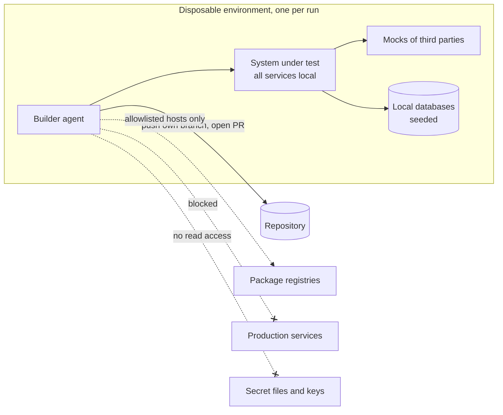

# 04. Sandboxes

> Each run gets a throwaway machine with the whole system inside it and nothing real within reach.

Agents on laptops are limited to human speed, see the developer's keys and are impossible to
govern across a team [S4][S7]. In the cloud, every run starts clean, can run in parallel and has
only the access you give it.

## Rules

- **SB-01** Builder runs MUST execute in an isolated, disposable environment created for that run
  and destroyed after it.
- **SB-02** The environment MUST be able to run the whole system under test locally, with mocks
  for every third-party and production service.
- **SB-03** No agent MAY touch production services to test its work.
- **SB-04** Secrets MUST NOT be readable by the model. Network egress MUST be restricted to an
  allowlist by default.
- **SB-05** Sandbox limits MUST be enforced at the operating system level (files, folders, hosts,
  child processes), not only by tool permissions.
- **SB-06** What leaves the sandbox (commits, pushes, messages, comments) MUST still pass deny rules
  and the merge policy.

## Diagram

## Why

- A team that moved every service into containers with mocks, one VM per agent, made it possible
  for agents to test anything without risk [S1].
- In the cloud there is no `.env`, no SSH key and no personal token for the model to find;
  secrets can be injected at the network layer [S1][S7].
- `npm test` can run a compromised dependency. Only an OS-level sandbox limits what it reaches [S7].

## Sources

[S1] [S4] [S5] [S6] [S7]

## Go deeper

1. [Disposable environments](disposable-environments.md): images, snapshots, lifetime.
2. [Local with mocks](local-with-mocks.md): running the full system without real services.
3. [Secrets and network](secrets-and-network.md): what the model can and cannot reach.
4. [Parallel work isolation](parallel-work-isolation.md): worktrees and branches when several agents share a repository.

## Up

[Manifesto](../../README.md)
