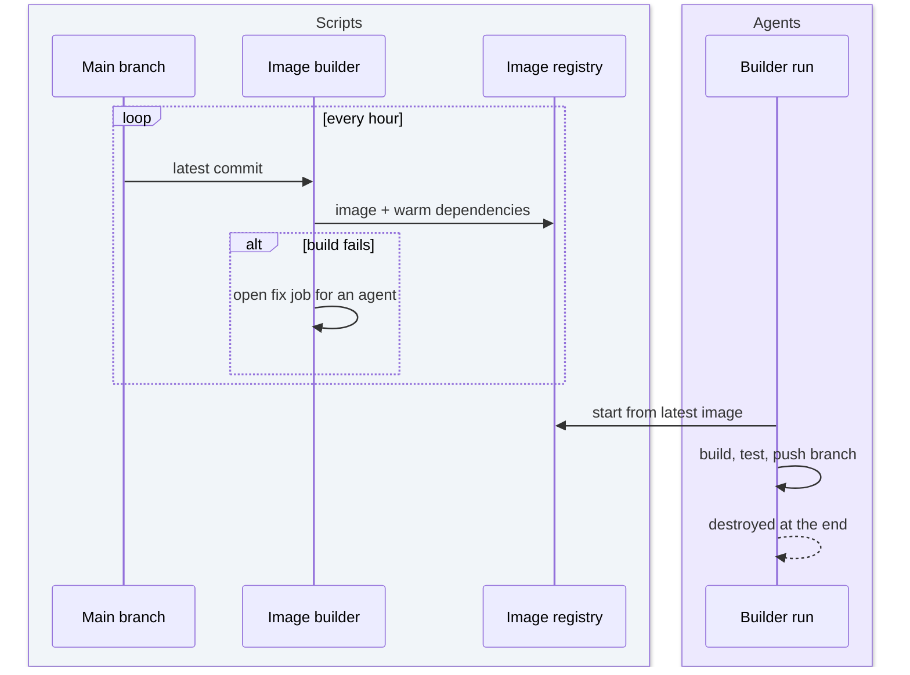

# Disposable environments

> **In short:** the run environment is a build artifact. You version it and rebuild it. You
> never tune it by hand.

## The problem

A machine that someone fixes by hand drifts. Nobody knows exactly what is on it, and the next run
inherits whatever the last one left behind.

A run that never ends is a problem too. It keeps spending money, and it keeps whatever access it
had.

## How it works

1. **Define the environment in the repository**: a versioned image plus a setup script.
2. **Rebuild the image on a schedule** from the latest main branch. Runs then start with
   dependencies already installed and with current code.
3. **Let an agent fix a broken build.** When the image build fails, the factory opens a job to
   fix it. An agent is the first responder, not a person.
4. **Start each run from the latest image**, with a wall-clock limit.
5. **Destroy the environment at the end**, also when the run fails. Only what the run publishes
   survives: its branch, PR, artifacts and memory entries.

The diagram shows the image being rebuilt every hour, and a run starting from it.

## Example

The run for Ana's bug starts from the latest image. The `reports` dependencies are already
installed, so the builder goes straight to work. It pushes `factory/issue-412`, publishes the test
output as an artifact, and the environment is destroyed.

If the run had crashed halfway, the environment would be destroyed all the same. The next
attempt starts clean.

> [!WARNING]
> **Patching the environment by hand.** Someone logs in and installs a missing tool. It works
> until the next rebuild, which loses the fix. Change the image or the setup script instead.

## Checklist

- **SB-07** Run environments MUST be created from a versioned image plus a setup script kept in
  the repository.
- **SB-08** The image or snapshot SHOULD be rebuilt on a schedule from the latest main branch, so
  runs start with warm dependencies and current code.
- **SB-09** When the image build breaks, the factory SHOULD open a job to fix it, so an agent is
  the first responder.
- **SB-10** Every run MUST have a wall-clock limit and MUST be destroyed at the end, also when it
  fails.
- **SB-11** Nothing a run produces MAY persist except what it explicitly publishes (branch, PR,
  artifacts, memory entries).

## Sources

[S1] [S7] [R]

## Up

[04. Sandboxes](README.md)
