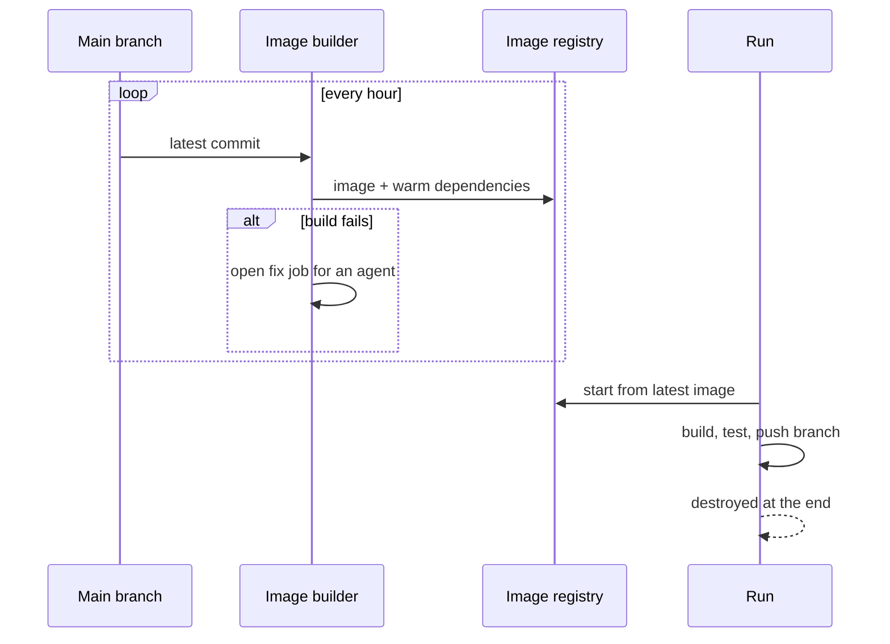

# Disposable environments

> The run environment is a build artifact, versioned and rebuilt, never hand-tuned.

## Rules

- **SB-07** Run environments MUST be created from a versioned image plus a setup script kept in
  the repository.
- **SB-08** The image or snapshot SHOULD be rebuilt on a schedule from the latest main branch, so
  runs start with warm dependencies and current code.
- **SB-09** When the image build breaks, the factory SHOULD open a job to fix it, so an agent is
  the first responder.
- **SB-10** Every run MUST have a wall-clock limit and MUST be destroyed at the end, including
  on failure.
- **SB-11** Nothing a run produces MAY persist except what it explicitly publishes (branch, PR,
  artifacts, memory entries).

## Diagram

## Sources

[S1] [S7] [R]

## Up

[04. Sandboxes](README.md)
