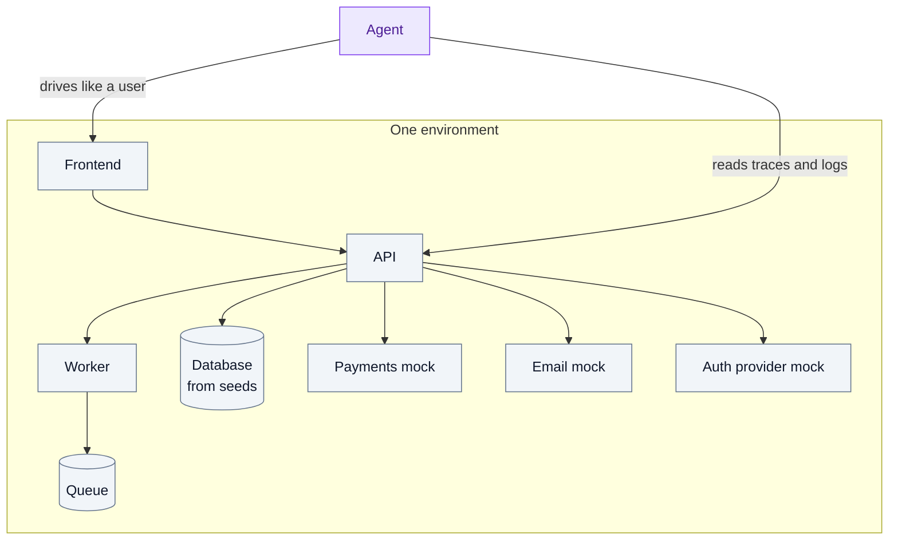

# Local with mocks

> **In short:** if an agent can't run the system, it can't check its own work. Make the whole
> system start in one environment, with mocks for everything outside it.

## The problem

An agent that only reads and edits code is guessing. To know that a fix works, it has to start
the software, use it and look at the result.

Many teams try to solve this with a shared staging environment. With agents, that breaks down.
Several runs compete for the same servers, and one run's data leaks into the next.

## How it works

1. **Start every service with one command**, for example with a compose file.
2. **Mock every third-party dependency** in the same environment: payments, email, auth
   providers, external APIs. A mock is a local stand-in that answers like the real service.
3. **Start databases from seeds** or fixtures kept in the repository, so every run sees the same
   data.
4. **Let the agent drive the system** like a user, and read its traces and logs.
5. **List what can't run locally.** A service that can't run this way is a gap. Write down the
   work needed to close it before the factory builds features on that service.

The diagram shows one environment with the whole system inside it.

## Example

For Ana's bug, the builder starts the `reports` service with one command. The database comes up
from the repository's seeds, which include a customer in "São Paulo". The auth provider is a mock.

The builder logs in, exports the CSV through the API and checks the accents in the file. It never
touches staging or production. The next run gets the same seeded data, whatever this run changed.

> [!TIP]
> Start with one pilot service. List what stops it from running fully inside a container with
> mocks, and close those gaps before you turn on autonomous building for it. This is slow work.
> The teams that report high volume say it is what made that volume possible [S1].

> [!WARNING]
> **Verifying on shared staging.** Runs wait for each other, and one run's data changes what the
> next one sees. A check that passes there may not mean anything.

## Checklist

- **SB-12** Every service the factory works on MUST start locally with one command (for example a
  compose file).
- **SB-13** Every third-party dependency (payments, email, auth providers, external APIs) MUST
  have a mock that runs in the same environment.
- **SB-14** Databases MUST start from seeds or fixtures kept in the repository.
- **SB-15** Shared staging environments SHOULD NOT be used for agent verification. They create
  contention and leak state between runs.
- **SB-16** A service that can't run locally MUST be listed as a gap, with the work needed to
  close it, before the factory is allowed to build features on it.

## Sources

[S1] [S2]

## Up

[04. Sandboxes](README.md)
