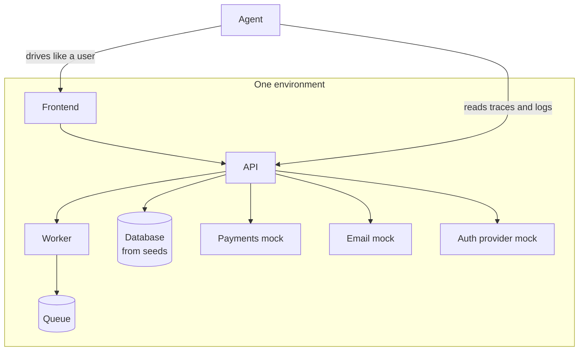

# Local with mocks

> If an agent cannot run the system, it cannot check its own work.

## Rules

- **SB-12** Every service the factory works on MUST start locally with one command (for example a
  compose file).
- **SB-13** Every third-party dependency (payments, email, auth providers, external APIs) MUST
  have a mock that runs in the same environment.
- **SB-14** Databases MUST start from seeds or fixtures kept in the repository.
- **SB-15** Shared staging environments SHOULD NOT be used for agent verification; they create
  contention and leak state between runs.
- **SB-16** A service that cannot run locally MUST be listed as a gap, with the work needed to
  close it, before the factory is allowed to build features on it.

## Diagram

## How to apply

Pick one pilot service. List what stops it from running fully inside a container with mocks.
Close those gaps before turning on autonomous building for that service. This is slow work, and
it is what made high volume possible for the teams that report it [S1].

## Sources

[S1] [S2]

## Up

[04. Sandboxes](README.md)
