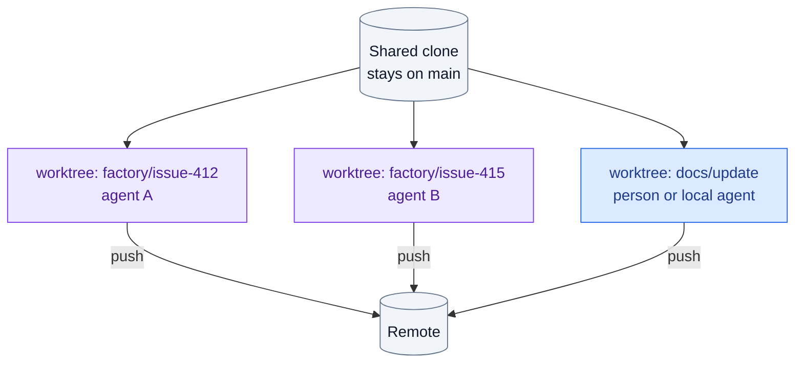

# Parallel work isolation

> **In short:** give each job its own branch and its own working copy. Two agents in one working
> tree make one corrupted working tree.

## The problem

A git checkout has one current branch. If two agents work in the same folder, one switches the
branch under the other. Edits land on the wrong branch, or get mixed into one commit.

Running too many jobs at once causes a different problem. Jobs compete for machines and money, and
nobody can follow what is happening.

## How it works

1. **Give each job its own branch**, named after the job, for example `factory/issue-<n>`.
2. **In the cloud, give each job its own environment.** Isolation then comes for free.
3. **Locally, give each agent its own git worktree** (a second working folder linked to the same
   clone). Create it from an up-to-date main. Never switch branches in the shared checkout.
4. **Remove the worktree** after its branch is pushed.
5. **Cap concurrency.** A limit sets how many jobs run at once.

The diagram shows a shared clone that stays on main, with one worktree per job.

## Example

The builder for Ana's bug works on `factory/issue-412`. At the same time, a developer fixes a
typo in the docs from the same clone. She creates her own worktree from main and leaves the shared
checkout alone.

Both push their branches. Each worktree is removed after its push. Neither job ever sees the
other's files.

> [!TIP]
> In git, `git worktree add <folder> -b <branch> origin/main` creates the worktree, and
> `git worktree remove <folder>` cleans it up.

## Checklist

- **SB-22** Each job MUST work on its own branch, named after the job (for example
  `factory/issue-<n>`).
- **SB-23** In the cloud, each job MUST get its own environment, which makes this isolation
  automatic.
- **SB-24** When agents run locally in a shared clone, each MUST use its own git worktree created
  from an up-to-date main, and MUST NOT switch branches in the shared checkout.
- **SB-25** A worktree MUST be removed after its branch is pushed.
- **SB-26** A concurrency limit MUST cap how many jobs run at once.

## Sources

[S3] [S6] [S7] [R]

## Up

[04. Sandboxes](README.md)
