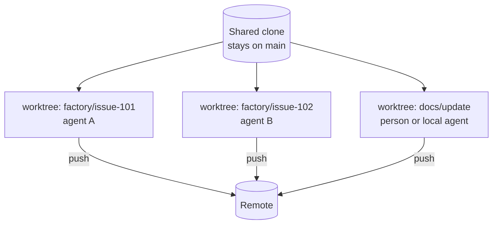

# Parallel work isolation

> Two agents in one working tree is one corrupted working tree.

## Rules

- **SB-22** Each job MUST work on its own branch, named after the job (for example
  `factory/issue-<n>`).
- **SB-23** In the cloud, each job MUST get its own environment, which makes this automatic.
- **SB-24** When agents run locally in a shared clone, each MUST use its own git worktree created
  from an up-to-date main, and MUST NOT switch branches in the shared checkout.
- **SB-25** A worktree MUST be removed after its branch is pushed.
- **SB-26** A concurrency limit MUST cap how many jobs run at once.

## Diagram

## Sources

[S3] [S6] [S7] [R]

## Up

[04. Sandboxes](README.md)
